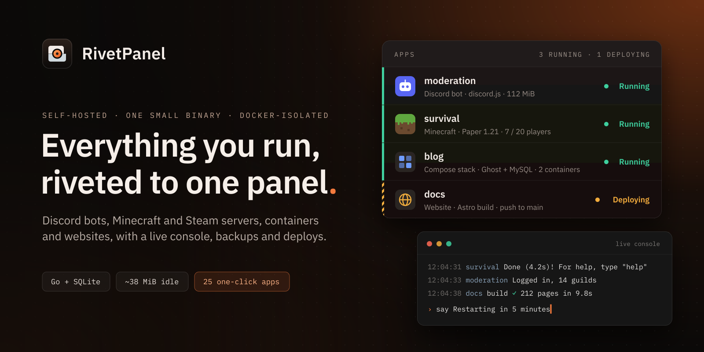
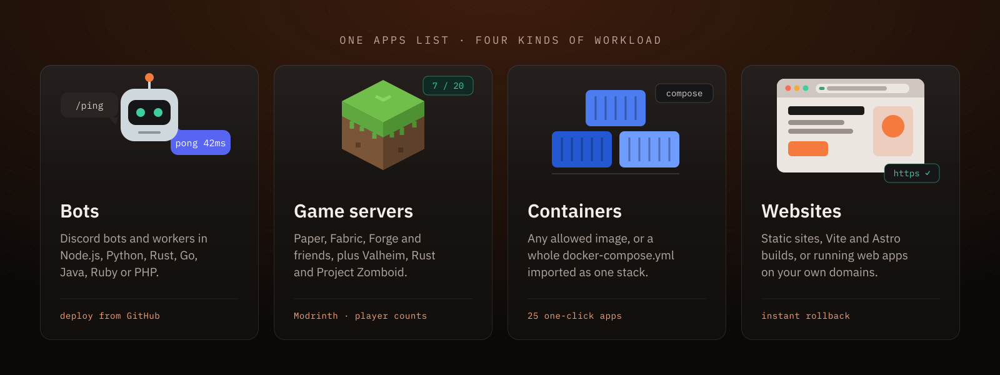
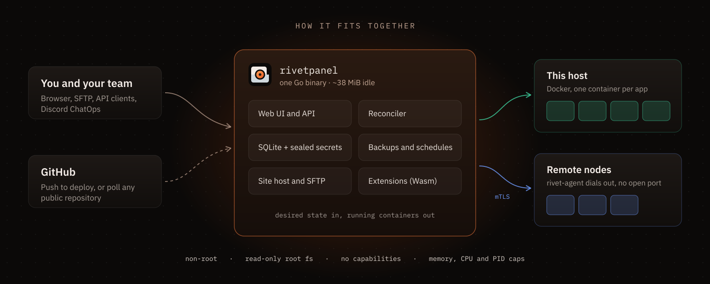

<p align="center">
  
</p>

<p align="center">
  <a href="CHANGELOG.md"></a>
  
  
  
  <a href="https://github.com/xenycx/rivetpanel/pkgs/container/rivetpanel"></a>
</p>

<p align="center">
  <a href="#-quick-start"><b>Quick start</b></a> ·
  <a href="#-what-you-get"><b>Features</b></a> ·
  <a href="docs/README.md"><b>Documentation</b></a> ·
  <a href="CHANGELOG.md"><b>Changelog</b></a>
</p>

---

You have a Discord bot on one VPS, a Minecraft server your friends keep
asking you to restart, a Ghost blog in a forgotten `docker-compose.yml` and a
static site that deploys "when you remember". **RivetPanel puts all of it in
one place**: one panel, one login, one list of apps, each running in its own
locked-down container on machines you own.

It is a single Go binary with SQLite inside. No database server, no message
broker, no cloud account. It idles at about **38 MiB of RAM**, so it is happy
on the smallest VPS you have.

<p align="center">
  
</p>

## ✨ Why people pick it

- **It tells you the truth.** Every app has a desired state and a reconciler
  that drives Docker toward it. Crash the host mid-deploy, lose a Docker
  response, restart the panel: when it comes back, it knows what should be
  running and makes it so.
- **Safe by default.** Apps run as a non-root user, with a read-only root file
  system, no Linux capabilities, and memory, CPU and process caps. Secrets
  are encrypted with AES-256-GCM and masked everywhere.
- **Push and forget.** Point an app at a GitHub repository (yours or any
  public one) and it rebuilds on push, with instant rollback if the new
  version misbehaves.
- **Made for groups.** Team workspaces, roles, invitations, support tickets,
  a help center and a public status page, so you can host for a community and
  not just for yourself.
- **One small thing to run.** One binary or one container next to Docker.
  Add more machines later with a tiny agent that dials out to the panel, so
  nodes never need an open management port.

## 🧰 What you get

### 🤖 Bots
- Starter templates that work out of the box: **discord.js**, TypeScript,
  **discord.py**, Poise, **JDA**, DiscordGo, discordrb. Add the token, press start.
- Any **Node.js, Python, Rust, Go, Java, Ruby or PHP** project from GitHub.
  *Analyze repository* detects the language, commands, variables and databases
  for you.
- **Live console** with input, reconnect and resume, plus live CPU, memory,
  disk and network gauges.
- Private **PostgreSQL, Redis, MongoDB or MariaDB** per bot on an internal
  network, with connection variables filled in.
- A visual **package manager** (npm, pip, Cargo, Go modules), a web file editor,
  zip upload and **SFTP**.
- **Bot Sites**: give a bot a public page, generated or hand-written.

### 🎮 Game servers <sub>preview</sub>
- **Minecraft**: Paper, Purpur, Vanilla, Fabric, Forge, NeoForge, Folia and
  Velocity, with checksum-verified downloads and the right Java picked for you.
- **Steam**: Valheim, Rust and Project Zomboid through anonymous SteamCMD.
- Install plugins and mods from **Modrinth**, manage players and edit
  `server.properties` in the browser. Player counts, JVM presets (Aikar's flags,
  ZGC) and graceful stops are built in.
- Bring your own Pterodactyl **eggs**: they become reviewable server types.

### 📦 Containers, stacks and one-click apps <sub>preview</sub>
- Run any image from an allowed registry (Docker Hub, GHCR and Quay by default)
  with its own console, files, variables, ports, volumes, backups and limits.
- Import a **`docker-compose.yml`** as a stack. You see exactly what will be
  created first, and dangerous options (privileged mode, host namespaces, the
  Docker socket) are refused.
- **25 one-click apps** with their database and admin account already set up:
  Ghost, Vaultwarden, n8n, Gitea, Uptime Kuma, Miniflux, Actual Budget,
  Excalidraw, Umami and more.
- An in-browser **terminal** inside the running container (never the host),
  with every session audited.

### 🌐 Websites
- **Static sites** from a ZIP, the built-in editor or GitHub.
- **Static builds** for Vite, SvelteKit, Astro, Next.js export and Nuxt, rebuilt
  on every push.
- **Web apps** in Node.js/TypeScript, PHP/Laravel, Python, Go and Rust with
  variables, a persistent `/data` folder, databases, health checks and release
  commands.
- **Custom domains** with DNS verification, TLS on demand through your reverse
  proxy, `_redirects`/`_headers`, and instant rollback.

### 🛠️ Day-to-day operations
- **Backups** for every app, automatic by default, with verify, download and
  restore, plus whole-installation backup and restore from the command line.
- **Schedules** for backups, restarts, deploys and console command chains.
- **Notifications** in the panel, by email (Mailgun) or to Discord.
- An **AI assistant** on every page (bring an OpenAI-compatible provider) that
  reads console output, build logs and files to answer *"why did it crash?"*,
  and only changes things after you approve.
- An administrator **Host** page with live and historical charts, daily log
  files with an archive job, and a <kbd>Ctrl</kbd>+<kbd>K</kbd> palette that
  finds anything.

### 👥 Teams and sign-in
- Workspaces with owner, admin, developer and viewer roles, custom account
  roles built from named permissions, per-app sharing and a workspace
  allowance (apps, sites, memory and CPU per workspace, with its source shown).
  Bots, sites and workspaces take an uploaded logo; anything without one gets
  a generated picture you can re-roll with **New picture**.
- Sign in with **GitHub, Discord, any OpenID Connect provider or a passkey**,
  with two-step codes and scoped **API clients** for automation.
- Support tickets, a Markdown **help center** at `/help` and a public **status
  page** at `/status`.

### 🧩 Extensions and remote nodes <sub>preview</sub>
- Signed **WebAssembly extensions** that run sandboxed with only the
  capabilities an administrator grants. Built in: Discord bot insights,
  **Discord ChatOps** (`/status`, `/logs`, `/restart` from your server), and a
  database browser for database add-ons and SQLite files.
- **Remote nodes**: enroll other Docker hosts with a one-use token. The
  `rivet-agent` connects out over mutual TLS and handles console, files,
  backups, deploys and stats for the apps placed on it.

<p align="center">
  
</p>

## 🚀 Quick start

You need a Linux machine (amd64 or arm64) with Docker.

### With Docker Compose

```sh
curl -O https://raw.githubusercontent.com/xenycx/rivetpanel/main/compose.yaml
curl -o .env https://raw.githubusercontent.com/xenycx/rivetpanel/main/deploy/container.env.example
sudo install -d -m 0750 /var/lib/rivetpanel
docker compose run --rm rivetpanel keygen
docker compose run --rm rivetpanel create-admin you@example.com
docker compose up -d
```

Open `http://127.0.0.1:8080`, sign in, and pick **New** to create your first
app. Put the panel behind Caddy, nginx or a Cloudflare Tunnel to reach it from
outside. Read [the container guide](docs/container.md) before you mount the
Docker socket: whoever controls it controls the host.

### As a single binary with systemd

```sh
rivetpanel keygen                          # encryption key and agent CA, kept outside the database
rivetpanel create-admin you@example.com    # asks for the password
rivetpanel                                 # serves on RIVET_LISTEN (default 127.0.0.1:8080)
```

Skip `create-admin` if you prefer: the panel prints a one-time setup code in
its log, and `/setup` in the browser takes it from there. The full production
walkthrough (reverse proxy, upgrades, rollback) is in
[docs/deployment.md](docs/deployment.md).

> [!NOTE]
> RivetPanel is a clean break from its predecessor, BotPanel. It does not read
> or convert old databases; start with a new `RIVET_DB_PATH`. See
> [upgrading from 0.4](docs/upgrading-from-0.4.md).

## 🔒 Honest about the boundaries

We would rather you know the limits up front than find them in production.

- **The panel holds the Docker socket**, which is root-equivalent on the host.
  Its systemd sandbox limits the blast radius but does not remove that
  privilege. Run it as root via systemd in production
  ([why](docs/deployment.md)).
- **Egress and disk quotas are not enforced** by RivetPanel. Of the four
  limits, only an app's size (memory, CPU, processes) is a kernel limit, set
  by Docker; the workspace allowance, node budget and node maximum are
  admission rules in the application
  ([how limits work](docs/features.md#capacity-and-admission)). Read
  [docs/isolation.md](docs/isolation.md) before hosting people you don't trust.
- **Remote placement is manual.** You choose the node (or a default); there is
  no capacity-based scheduler, live migration or high availability. Panel and
  agents must be upgraded together.
- **Game servers** cover Minecraft Java and three SteamCMD games with anonymous
  downloads only: no Bedrock, mounts, FastDL or automatic subdomains.
- **Builds need real memory.** The Rust recipe reserves 3 GiB for its build
  container, because `rustc` is killed at 1.5 GiB without swap.
- Console log delivery is at-least-once across reconnects, not exactly-once.

Everything that is a *preview* above is opt-in and still settling. The
[implementation status](docs/implementation-status.md) lists what is done and
what is not, and [docs/features.md](docs/features.md) lists every feature
with its limits.

<details>
<summary><b>How it was tested</b></summary>

<br>

Last full run: 2026-09-30, Linux 7.2.5 x86_64, Go 1.27.1, Node 26.8.1.

| Check | Result |
| --- | --- |
| `go vet`, `go test ./...`, `go test -race ./internal/...` | pass |
| `svelte-check` | 0 errors |
| Real-Docker integration tests (`make integration`), all 15 | pass on a fresh rootful Docker 29.7.2 (cgroup v2): every language runtime, lifecycle, isolation, crash restart, adoption after a panel restart, OOM, build failure, backup and restore, console reconnect and slow clients, published ports and more |
| Every bot template built and run in real containers | discord.js, discord.py, DiscordGo, JDA and Poise each reached Discord's login |
| Real browser (Playwright, Chromium), 30 checks | pass, including phone width with no horizontal scroll |
| Real OpenSSH `sftp` client | file operations work; traversal, foreign folders and shell commands are refused |
| Idle memory, panel and runner | 36.6–38.6 MiB over three starts ([footprint](docs/footprint.md)) |

Not verified against the live services (no accounts were available): the
GitHub and Discord OAuth exchanges, GitHub webhooks and API, and Discord
webhook posting. They are tested against fake servers that reproduce the
documented requests and responses. Also not exercised: the default non-root
container uid 65532, other CPU architectures, and load with many bots.

</details>

## 📚 Documentation

| Get it running | Use it | Understand it |
| --- | --- | --- |
| [Deployment](docs/deployment.md) | [Features](docs/features.md) | [Architecture](docs/architecture.md) |
| [Container install](docs/container.md) | [Game servers](docs/game-servers.md) | [Isolation](docs/isolation.md) |
| [Backups](docs/backup.md) | [Containers and stacks](docs/containers.md) | [Remote nodes](docs/agents.md) |
| [OAuth sign-in](docs/oauth.md) | [Websites](docs/sites.md) | [Footprint](docs/footprint.md) |
| [SSO, passkeys, API clients](docs/auth.md) | [Workspaces](docs/workspaces.md) | [Implementation status](docs/implementation-status.md) |
| [Email](docs/email.md) | [Roles and permissions](docs/permissions.md) | [Changelog](CHANGELOG.md) |
| [Logs and retention](docs/logs.md) | [Extensions](docs/extensions.md) · [AI operator](docs/ai-operator.md) | [All guides](docs/README.md) |

The panel also ships its own guide at `/docs`.

## 🏗️ Build from source

Requires Go 1.27 or newer and Node 22 or newer.

```sh
make build        # web UI plus bin/rivetpanel and bin/rivet-agent
make run-dev      # development mode: data under ./.dev-data, dev key created for you
make check        # go vet, go test, svelte-check
make integration  # real-Docker tests; needs a DISPOSABLE Docker daemon (see the Makefile)
```

Other commands: `backup`, `backup-verify`, `restore` and `verify`
([docs/backup.md](docs/backup.md)). The version lives in [`VERSION`](VERSION)
and every change is recorded in the [changelog](CHANGELOG.md).

---

<p align="center">
  <br>
  <sub>Built for people who would rather run their own stuff.<br>
  Game names and logos belong to their owners. Generated logos by <a href="https://www.dicebear.com">DiceBear</a>.</sub>
</p>
