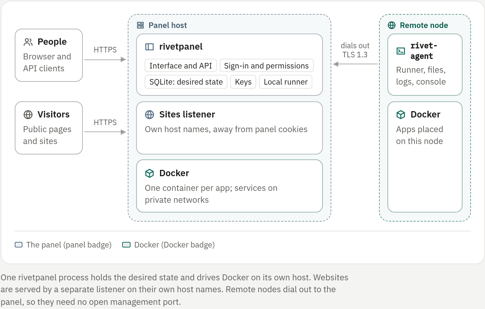

## Apps

An **app** is anything the panel runs for you: a bot, a game server, a
container or a website's web app. Each app runs in its own Docker container
and has the same page, tabs, power controls and permissions, whatever its
kind. Internally every app is a row of the same table, which is why the API
routes for all of them start with `/api/v1/bots/{id}`.

A website is either static (files served as they are) or an app (a server
process). See [Bot Sites](../04-websites/01-bot-sites.md).

## Workspaces

A **workspace** groups apps and sites for a person or a team. Every account
has one **Personal** workspace; team workspaces add members with the owner,
admin, developer and viewer roles. Limits on apps, memory and CPU are set per
workspace. See [Workspaces](../06-teams/01-workspaces.md) and
[Limits](../06-teams/04-limits.md).

## Nodes

A **node** is a Docker host that runs apps.

| Node | How the panel reaches it |
|---|---|
| The local runner | Inside the panel process, through the local Docker socket |
| A remote node | Through `rivet-agent`, which dials out to the panel over TLS 1.3 with yamux, so the node needs no open management port |

The agent offers its runner, files, logs, console input, stats and game
queries only inside that authenticated connection. Desired state stays in the
panel's database, and the agent resynchronizes it after reconnecting. See
[Remote nodes](../07-operate/04-remote-nodes.md).

<!-- figure: system-map -->

> [!WARNING]
> Neither runner is a security boundary from its Docker daemon. The panel
> holds the local Docker socket when local execution is on, and each agent
> holds its node's Docker socket; both are root-equivalent. A node
> certificate authenticates the agent and binds it to one node. It does not
> attest a hostile node or enforce network or kernel policy. [not enforced]
> See [Security model](../07-operate/08-security.md).

## The sites origin

Websites are served by a separate listener (`RIVET_SITES_LISTEN`) on host
names that differ from the panel's, for example `docs.sites.example.com`.
Site files are arbitrary HTML and scripts: on the panel's own origin they
could read its CSRF tokens or act as the signed-in user, and on their own
host names they cannot. [enforced: panel] See
[Domains](../04-websites/04-domains.md).

## Desired and observed state

Every app has two states:

| Field | Meaning |
|---|---|
| `desired_state` | What you asked for: `stopped`, `running` or `deleted` |
| `observed_state` | What the runner last saw |
| `generation` | A counter that increases whenever intent or configuration changes |

Start, stop, restart, an edit or a variable change raises the generation in
the same database transaction. The runner writes its observations only for
the generation it worked on, so a pass working on old intent can never
overwrite newer intent.

| Request | Effect |
|---|---|
| `POST /bots/{id}/start` | desired `running`; the generation rises only if the app was not already running |
| Repeated `start` | No change; answers `202` with the current generation |
| `POST /bots/{id}/restart` | desired `running`; the generation always rises, which replaces the container |
| `POST /bots/{id}/stop` | desired `stopped`; the generation rises if the app was running |
| `DELETE /bots/{id}` | desired `deleted`, then the containers, the workspace files and only then the row |

All lifecycle calls answer `202` at once; nothing waits for a pull or a
build.

A bot's configuration and variables can be edited at any time. On a stopped
bot (desired `stopped`, observed `stopped`, `failed` or `unknown`) a change
that shapes the container raises the generation. On a live bot it does not:
the running container is kept, the bot reports `restart_pending: true`, and
the next start, restart or crash recovery creates the container with the new
settings. A new name, restart policy or backup setting takes effect at once
and leaves nothing pending. Published ports, services, restores and game
server reinstalls still need a stopped app.

### Phases

The API sums intent and observation up as one `phase`, so no client has to
guess from error text:

| Phase | Meaning |
|---|---|
| `queued` | The intent is recorded; the runner has not picked it up yet |
| `building`, `installing` | A bot's build, or a game server's installation, is running |
| `starting`, `running` | The container is starting or runs (a container app shows `starting` while its image is pulled) |
| `restarting` | The container is being replaced |
| `retrying` | It failed and the runner will try again |
| `failed` | The runner gave up, or the failure is not retried (for example a port conflict) |
| `exited` | The process ended cleanly |
| `stopping`, `stopped` | Stopping as asked, or stopped |
| `checking` | The panel just started and is checking what really runs |
| `no_runner`, `runner_offline` | No runner serves the app's node, or it cannot be reached |
| `deleting` | Being deleted |

The API also reports the restart count, the next retry time and a reason
code. See [Bots and processes](../02-apps/01-bots.md#lifecycle-and-power-controls).

## Reconciliation

The runner drives Docker toward the desired state, one pass per app at a
time, with a bounded pool of workers:

1. Read the app. If it no longer exists, remove any orphan containers.
2. List the managed containers by their labels: `rivetpanel.managed`, the
   installation, the app, the node, the generation, the role and a spec hash.
   Containers are named `rivetpanel-<id>-<role>`.
3. Reuse a running container only if its generation and spec hash match.
   Otherwise stop and remove it. Builders left over from an interrupted pass
   are removed too.
4. Otherwise build: resolve the image, prepare the workspace's ownership and
   run the build stage if the recipe needs one. Re-read the intent, create the
   container, record its ID, re-read the intent again, then start it.
5. On failure, record a generic message (never Docker's error text, which may
   contain paths or names) and retry with bounded exponential backoff, from
   1 second to 5 minutes, however many events arrive.

Docker and SQLite cannot commit together. Safety after a crash or a lost
response comes from deterministic names, labels, one pass per app at a time
and listing containers again before creating one. The spec hash leaves out
variable values (a change raises the generation instead), so a label never
fingerprints a secret.

### When the runner resynchronizes

- When the panel starts: live observations are first set to `unknown`.
- On Docker events.
- Every 30 seconds, which also removes orphan containers.
- When the Docker connection is lost: the runner reports not ready, then
  resynchronizes.

The runner owns restarts; Docker's own restart policy is turned off. It
applies the app's restart policy when it sees a container exit. A remote
runner also backs off when resynchronizing with the panel fails, so an
offline panel cannot cause a reconnect and logging loop.

### Services

An app's companion databases are reconciled in the same pass. Before the app's
container is created, the runner:

1. ensures the private network `rivetpanel-<app>-net`;
2. creates or starts each service container, `rivetpanel-<app>-addon-<kind>`,
   reused while its spec hash (which leaves out the password) is unchanged;
3. waits for their Docker health checks;
4. creates the app, connects it to the network and starts it.

Stopping the app stops its services. Deleting it removes their containers,
the network and the data directory. Service containers are never replaced as
outdated the way stale app containers are. See [Services](../02-apps/07-services.md).

## The console

The console is a WebSocket at `GET /bots/{id}/console`, opened after the
sign-in, permission, same-origin and connection-limit checks.

- Each connection has a bounded queue of 128 messages of at most 8 KiB. When
  it is full, the newest message is dropped and counted, and the client
  receives `{"type":"dropped","count":N}`. A failed or timed-out write ends
  the session. Docker's stream is always read, however slow the client is.
- Docker logs have no durable cursor. A client resumes with
  `since=<last timestamp>` and lines at or before it are skipped, so delivery
  is at least once: a line may repeat, or very rarely be lost when several
  share the same nanosecond. Output written while no container existed does
  not exist.
- The stream follows an app across container replacements by itself.
- Typing into the console is authorized separately from viewing it, goes to
  the app's process (not a shell), is rate limited and has one writer per app.
  [enforced: panel] Containers keep stdin open, so closing a browser tab
  neither stops the app nor closes its input.

## Data at rest

The panel's SQLite database (WAL mode, a small connection pool) holds the
desired state, configuration and history. Environment values are encrypted
with AES-256-GCM, bound to the app, the variable name and the key ID; the
keys are files under `RIVET_KEY_DIR`. [enforced: panel]

Encryption protects the database and its backups. It does not protect values
from anyone with Docker access, because the plain value is in the container's
environment. [not enforced]

Console output is never stored in SQLite. Docker keeps it in rotated
`json-file` logs (3 files of 10 MB per container), and the panel writes daily
log files. See [Logs](../05-observe/06-logs.md).

## Permissions and background work

Every app-scoped route, WebSocket, event stream and SFTP operation is
authorized by one function, `BotService.Authorize(actor, app, permission)`.
[enforced: panel] Background work (backups, deployments, alerts) runs on the
server's context, never on a request's, and copies what it needs out of the
request first.

## Where things live in the source

| Package | Does |
|---|---|
| `internal/oauth` | GitHub and Discord sign-in (authorization code with PKCE) |
| `internal/service` | Apps, sign-in, alerts, GitHub deployments, backups, telemetry and permissions |
| `internal/github` | The GitHub REST client; deployments download tarballs, with no `git` on the host |
| `internal/sftpd` | The built-in SFTP server, over the contained file layer |
| `internal/pkgmgr` | Editors for `package.json`, `requirements.txt`, `pyproject.toml`, `Cargo.toml` and `go.mod` |
| `internal/templates` | The built-in bot starters |
| `internal/filesystem` | Contained file access, backup archives and staged repository deployments |
| `sdk/` | Telemetry snippets the panel serves to bots |
