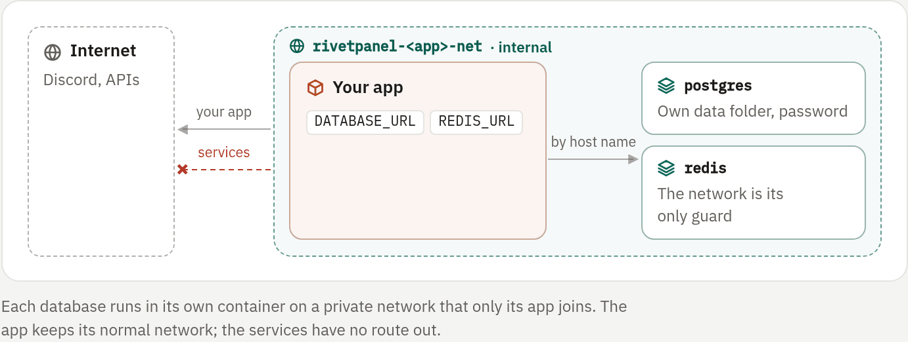

## Add a database

Add services while creating a bot (**Start, build and databases**), or on
an app's **Services** tab while the app is stopped. Adding one needs full
admin rights on the app.

| Service | Host name | Default memory | Connection variables |
|---|---|---|---|
| PostgreSQL 17 | `postgres` | 256 MiB | `DATABASE_URL`, `POSTGRES_HOST`, `POSTGRES_PORT`, `POSTGRES_USER`, `POSTGRES_PASSWORD`, `POSTGRES_DB` and the matching `PG*` names |
| Redis 7 | `redis` | 128 MiB | `REDIS_URL`, `REDIS_HOST`, `REDIS_PORT` |
| MongoDB 7 | `mongodb` | 512 MiB | `MONGODB_URI`, `MONGO_URL`, `MONGO_HOST`, `MONGO_PORT`, `MONGO_USER`, `MONGO_PASSWORD` |
| MariaDB 11 | `mariadb` | 384 MiB | `MYSQL_URL`, `MYSQL_HOST`, `MYSQL_PORT`, `MYSQL_USER`, `MYSQL_PASSWORD`, `MYSQL_DATABASE` |

The app receives these variables automatically. **Show connection** reveals
them. A game server's plugins read their own configuration files instead:
copy the host, user and password from **Show connection** into them.

### Use them from your own variables

Your own variables can reference a service's variables as `${NAME}`, for
example:

```text
YAGPDB_PQPASSWORD=${POSTGRES_PASSWORD}
```

Unknown references and lone `$` signs are left as written.

## Isolation

Each service is its own container, with: [enforced: docker]

- a memory limit, and CPU and process limits;
- a read-only root file system;
- all capabilities dropped and `no-new-privileges`;
- the panel's unprivileged container user.

Services join a private, internal Docker network per app,
`rivetpanel-<app>-net`. They have no internet access, and only that app and
its other services can reach them, by host name. [enforced: docker] The app
keeps its normal network and joins the private one as well; an app with
outbound access turned off uses only the private network.

<!-- figure: services-network -->


Passwords are generated (144 bits) and stored sealed like other variables, as
hidden `RIVET_ADDON_<KIND>_PASSWORD` rows, so key rotation and verification
cover them. They never appear in container labels. Redis has no password: the
private network is its access control.

## Lifecycle

- Services start before the app. The app is created only after their health
  checks pass, waiting up to three minutes.
- They stop with the app and keep their containers, so a restart reuses them.
- A crashed service is restarted while the app runs.
- The **Services** tab shows each one's state, health, memory, data size and
  last 200 log lines.

Service memory counts toward the workspace's memory allowance and the node's
budget. [enforced: panel]

## Data

A service's data lives in `<database directory>/addons/<app>/<kind>`,
outside the app's workspace: the file manager, SFTP and deployments never
touch it. Removing a service or deleting the app deletes its data.

> [!WARNING]
> Service data is not included in app backups or in `rivetpanel backup`.
> Dump it from the app if you need copies, for example with `pg_dump`.

With the extensions module on, the **database browser** extension adds a
**Data** tab for browsing and querying service databases and SQLite files in
the app's files. See [Extensions](../07-operate/09-extensions.md).

## Limits

- One service of each kind per app, so four at most. [enforced: panel]
- No version choice and no database extensions.
- No Lavalink yet.
