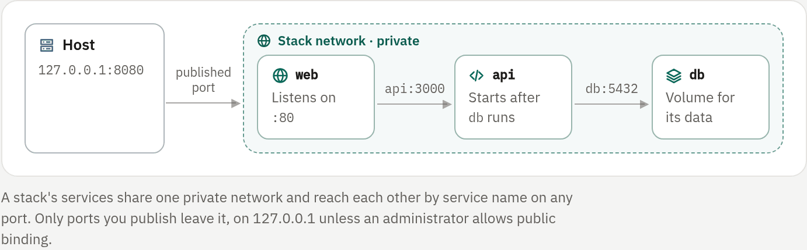

## What a container app is

A **container app** runs a Docker image you choose, such as `redis:7`,
`nginxinc/nginx-unprivileged:1.27` or `ghcr.io/owner/app:v1`. A **stack** is
a Compose file imported as several container apps that reach each other by
service name. A **one-click app** is a ready-made stack, such as Ghost,
Vaultwarden or n8n, with its database and sign-in already set up.

All of them live under **Apps → Containers** next to bots, game servers and
websites. They use the same console, files, variables, network, services,
backups, schedules, analytics and access tabs as every app.

Containers are a preview module (`containers`), on by default. An
administrator hides them by turning the module off under
**Administration → Modules**, or by allowing no registry
(`RIVET_CONTAINER_REGISTRIES=`).

## Run an image

1. Choose **New → Container → Docker image** (`/containers/new`).
2. Fill in the form (below).
3. Create the app.

| Field | What it does |
|---|---|
| **Image** | A reference from an allowed registry. A reference without a registry is Docker Hub: `nginx` is `docker.io/library/nginx:latest` |
| **Ports** | Container ports to publish. An empty host port takes the next free one from `RIVET_PORT_RANGE`. Ports bind to `127.0.0.1` unless an administrator allows public binding (`RIVET_PORT_PUBLIC_BIND`) |
| **Variables** | `KEY=value` lines, encrypted at rest like every app's |
| **Volumes** | A name and a folder inside the container. The data lives in the app's files under `volumes/<name>`, survives restarts and image changes, is included in backups and can be edited in **Files** or over SFTP |
| **Command** | Optional. Empty keeps the image's own entrypoint and command |
| **Writable paths**, **Run as**, **Memory** | Optional; see below |

Prefer a version tag. A moving tag such as `latest` is pulled once per host;
**Pull again** under **Configuration** fetches a newer one, and restarts the
app when it runs.

### Change it later

Under **Configuration**, the image, volumes, writable paths and user can be
changed at any time: a running app gets a new container with the new
settings. The command and the restart policy can change at any time too;
saved on their own while the app runs, they apply at its next restart.

Variables of a container app may use any name except `RIVET_*`, including
`PATH` and `LD_*`, which are reserved for bots because a bot's runtime limits
which commands run. A container runs whatever its image does anyway.

GitHub deployments, packages and build commands do not apply: the image is
the code.

## What every container gets

Containers run under the same isolation as every other app. [enforced: docker]

- **A read-only root file system.** An image that writes outside its volumes
  needs those folders listed under **Writable paths**: in-memory folders of
  16 MiB, empty at every start. `/tmp` is always writable.
- **No root.** Containers run as the panel's container user
  (`RIVET_CONTAINER_USER`), or a numeric `uid:gid` above 0 under **Run as**;
  user names are not accepted. An image that insists on starting as root
  needs its unprivileged variant, for example `nginxinc/nginx-unprivileged`
  instead of `nginx`. Docker lets unprivileged processes bind ports below
  1024 inside the container.
- **No capabilities**, `no-new-privileges` and Docker's default seccomp
  profile.
- **Memory, CPU and process limits.**
- **No host namespaces, devices or Docker socket.**
- The image's own working directory, with no `/workspace` mount.

Give each folder in which the image keeps data a volume, and list folders it
writes caches, sockets or PID files to as writable paths.

### Registries and image size

| Check | When | Enforced by |
|---|---|---|
| The image's registry is in `RIVET_CONTAINER_REGISTRIES` (default `docker.io,ghcr.io,quay.io`) | When the app is created, when its image changes, and again before every pull at start, since the policy may have narrowed | [enforced: panel] |
| The pulled image is no larger than `RIVET_CONTAINER_MAX_IMAGE_BYTES` (default 2 GiB; 0 means no limit) | After the pull | [enforced: panel] |

Pulled images use the host's disk; RivetPanel does not otherwise limit it.
[not enforced] Private registries are not supported: no registry credentials
are stored.

### Where containers run

Container apps run on the panel's own host; remote nodes do not run them yet.
Each container app, and each service of a stack, counts as one of the
workspace's **Bots and containers**, and toward its apps, memory and CPU
allowance. [enforced: panel] See [Limits](../06-teams/04-limits.md).

## Import a Compose file

1. Choose **New → Container → Compose stack** (`/stacks/new`).
2. Paste a `compose.yaml`, or open the file, and optionally a `.env` for
   `${VAR}` interpolation.
3. Press **Preview**. The preview is the exact plan the import follows: every
   service with its image, command, published ports, volumes, writable paths,
   variable names, dependencies and limits, every option the panel changes
   and every option it refuses.
4. Press **Create**. It is offered only when the preview has no errors and the
   file has not changed since.

Each service becomes a container app named `<stack>-<service>`. The services
of a stack share a private network without internet access, where each is
reachable by its service name (`db`, `redis`, …). Each service also keeps its
own outbound access unless it sets `network_mode: none`.

The whole stack is checked against the workspace's limits before anything is
created. If any service cannot be created, the ones already created are
removed again.

### How Compose keys are translated

| Compose | Becomes |
|---|---|
| `image` | The app's image (the registry policy applies) |
| `command`, `entrypoint` | The app's command and entrypoint; strings are split as Compose does, with no shell |
| `environment` (map or list), `${VAR}`, `${VAR:-default}` | The app's variables; values come from the `.env` box, and unset ones become empty with a warning |
| `ports` (`8080:80`, `127.0.0.1:8080:80/udp`, long form) | Published ports; a host port outside `RIVET_PORT_RANGE` or already in use moves to a free one, with a warning |
| `ports` without a host port (`"80"`), `expose` | Nothing: other services reach every port on the stack network |
| Named `volumes` | The app's volumes; a volume used by several services is copied per service (they do not share files), with a warning |
| `./relative:/path` bind mounts | An empty volume of that name, with a warning to upload the files |
| `/absolute:/path` host bind mounts | Not mounted, with a warning |
| `tmpfs`, `type: tmpfs` | Writable paths |
| `depends_on` (list or map) | The service waits until those services run; `service_healthy` and other conditions are treated as started |
| `user: "1000"` or `"1000:1000"` | Run as that user; `root` or names are ignored with a warning |
| `restart: "no"` | Never restarted; every other policy restarts after a crash |
| `mem_limit`, `cpus`, `deploy.resources.limits` | Memory and CPU limits (default 512 MiB and one core) |
| `network_mode: none` | No outbound access; the stack network stays |
| `profiles` | The service is skipped, as Compose does by default |

Well-known images get the writable paths they need: `nginx`
(`/var/cache/nginx`, `/var/run`), `postgres` (`/var/run/postgresql`), `mysql`
(`/var/run/mysqld`), `mariadb` (`/run/mysqld`), `httpd` and `mongo`.

### Refused and ignored keys

The preview lists refused keys as errors, and the import refuses them.
[enforced: panel]

| Treatment | Keys |
|---|---|
| Refused | `build`, `privileged: true`, `cap_add`, `security_opt`, `devices`, `sysctls`, `userns_mode`, `cgroup_parent`, `runtime`, `gpus`, `isolation`, `pid` or `ipc` sharing, `network_mode` other than `none` or `bridge`, `extends`, `include`, `secrets`, `configs`, `volumes_from`, any mount of the Docker socket, images from registries that are not allowed, and `depends_on` cycles |
| Ignored with a note | `healthcheck`, `working_dir`, `extra_hosts`, `dns`, `ulimits`, `init`, `platform`, `shm_size`, `env_file`, and replicas above one |
| Ignored silently | Names, labels, logging and other cosmetic keys |

A Compose file has at most 20 services and 256 KiB. [enforced: panel]

## Stacks

The stack page (`/stacks/<id>`) lists its services with their state and
starts, stops or restarts all of them.

- Services start in any order. Each one waits, shown as **Waiting**, until
  the services it depends on run.
- The Compose file is kept for reference; later changes are made per service.
- A service cannot be moved to another workspace or transferred on its own.
- Deleting the stack deletes every service with its files, volumes and
  backups.

<!-- figure: stack-network -->


### Docker networks

Each stack gets its own private Docker network, which takes a subnet from the
Docker daemon's address pools. With Docker's defaults there are only about 30
such subnets on a host, shared with every other Compose project.

On a host that runs many stacks, give Docker smaller, more numerous subnets
in `/etc/docker/daemon.json`, then restart Docker:

```json
{ "default-address-pools": [{ "base": "10.200.0.0/16", "size": 24 }] }
```

The panel removes a stack's network when the stack is deleted, and removes
idle networks of stopped stacks; they are created again on the next start.

## One-click apps

The catalog is listed under your containers in **Apps → Containers**, and
also under **Templates → Apps** and **New → Container → One-click app**.

1. Search or pick a category, and choose an app.
2. Give it a name and choose where it opens:
   - a **web address**: a site of this panel, such as
     `ghost.sites.example.com`, which can get its own domain later;
   - **port only**: a free host port from the panel's range, bound to
     `127.0.0.1` unless `RIVET_PORT_PUBLIC_BIND=1`.
3. Fill in the few values the app cannot choose itself: usually none, or an
   admin user name. Passwords, database passwords and secret keys are
   generated on the server with `crypto/rand`; **More options** lets you set
   them yourself.
4. Press **Install**. The stack page shows the containers starting (the first
   start pulls the images), then an **Open** button, the sign-in values
   behind **Show** (each reveal is audited like any variable reveal) and the
   app's first steps.

| Category | Apps |
|---|---|
| Publishing | Flarum, Ghost |
| Productivity | Actual Budget, Clipboard Vault, Excalidraw, Mealie, Memos, n8n, Stirling-PDF, Vikunja, Wiki.js |
| Developer tools | CyberChef, Gitea, IT-Tools |
| Monitoring | Gotify, ntfy, Umami, Uptime Kuma |
| Reading | linkding, Miniflux |
| Media and files | Navidrome |
| Security | PrivateBin, SearXNG, Vaultwarden |
| AI and agents | Herdr, ZeroClaw |

> [!WARNING]
> Many apps create their administrator on the first visit (Ghost, Gitea, n8n,
> Uptime Kuma, Wiki.js, Memos and others), and a few start with a published
> default login (Mealie, Umami). With a public web address, open the app and
> finish that step right after installing, before someone else does. The
> app's notes say which step it needs.

### How one-click apps work

- A template is a reviewed Compose file plus the variables it needs, built
  into the panel (`internal/apptemplates/data/<id>/`). Installing it fills
  the variables in and imports the file through the same Compose import as a
  pasted file. The import refuses everything else [enforced: panel], and
  every container gets the same isolation and registry policy as any other.
  [enforced: docker]
- The stored Compose file keeps its `${VAR}` placeholders; the values live
  only in each container's encrypted variables. Change them under the
  container's **Variables**, like any app's; a running container gets them
  when it restarts.
- Images are pinned to exact versions. To update an app, change a container's
  image under **Configuration**; read the app's upgrade notes first.
- Data lives in the containers' volumes (**Files → volumes/…**) and is part
  of their backups.
- Deleting the stack deletes the containers, their data and the app's web
  address.
- The installer reserves `APP_URL`, `APP_HOST`, `APP_PORT`, `APP_SCHEME`,
  `APP_SECURE`, `APP_ORIGIN` and `STACK_NAME`. An app that must know its own
  address (Ghost, Gitea, n8n…) gets it from `APP_URL`.
- Changing the address after installing is not offered yet: install the app
  again, or change the address variables of its containers by hand.
- An administrator can hide apps by narrowing `RIVET_CONTAINER_REGISTRIES`.
  An app whose image comes from a registry that is not allowed is shown as
  unavailable, with the reason.

### Trusted capabilities

A built-in template may ask that one of its services gets back one or more
of `CHOWN`, `SETUID`, `SETGID`, `DAC_OVERRIDE` and `FOWNER`, for images that
cannot run otherwise. Only the template installer can grant them:

- a pasted Compose file still has `cap_add` refused, and the API has no field
  for it; [enforced: panel]
- the Docker adapter drops any capability outside this list;
  [enforced: docker]
- the root file system stays read-only, `no-new-privileges` stays on, and
  root (`user: 0`) is still refused;
- changing such a container's image to another repository removes the
  capabilities.

The kernel enforces nothing beyond Docker's own capability handling.

### Web addresses

An app installed with a web address is a site (in the Websites list) in
**app** mode whose app is the template's web container.

- The container joins the shared apps network (`RIVET_APPS_NETWORK`, default
  `rivetpanel-apps`) under a private alias.
- The sites listener proxies the address to the container's port, with
  HTTPS, custom domains, the request body limit and the health check of any
  app site.
- The site does not own the container. Deleting only the site removes the
  address: the container leaves the apps network and keeps running. Deleting
  the stack deletes its sites.
- Other site apps on the apps network can reach the container, as for web
  apps.

On a server behind a reverse proxy such as Traefik, route the sites domain
(or each custom domain) to the sites listener, as for every site. See
[Domains](../04-websites/04-domains.md).

## Terminal

The **Terminal** tab of a running container app opens an interactive terminal
(`docker exec` with a TTY) inside it. It runs with the container's own user,
capabilities, read-only root file system and limits, never on the host.

- Only the app's owners and administrators can open it; on a shared app it
  needs full admin rights. [enforced: panel]
- Apps used from a terminal, such as Herdr, start their own command there.
  **New shell** opens `sh`.
- Every opened terminal is recorded in the audit log as `bot.terminal`, with
  the command.
- Terminals close after 30 minutes without input.
- Changes outside volumes disappear when the container is recreated.

## API

All routes need a signed-in session or an API client with the matching
permission; creating needs `bots.create`. Everything else (console, files,
variables, ports, backups, power) uses the same `/api/v1/bots/{id}/…` routes
as every app.

| Route | Does |
|---|---|
| `GET /api/v1/containers/policy` | Allowed registries, the image size limit, and whether ports bind publicly |
| `POST /api/v1/containers` | Create: `name`, `image`, `workspace_id`, `command`, `entrypoint`, `user`, `writable`, `volumes`, `ports`, `env`, `memory_bytes`, `nano_cpus`, `network_disabled`, `start` |
| `PUT /api/v1/bots/{id}/container` | Change `image`, `user`, `writable`, `volumes` |
| `POST /api/v1/bots/{id}/container/pull` | Pull the image again (restarts a running app) |
| `POST /api/v1/stacks/import` | `compose`, `env`, `name`, `workspace_id`, `dry_run`, `start`; returns the plan, and the stack when created |
| `GET /api/v1/stacks`, `GET /api/v1/stacks/{id}` | Stacks with their services |
| `PATCH /api/v1/stacks/{id}` | Rename |
| `POST /api/v1/stacks/{id}/start` (`stop`, `restart`) | Power for every service |
| `DELETE /api/v1/stacks/{id}` | Delete the stack, its services and their web addresses |
| `GET /api/v1/app-templates` | The one-click catalog: each app's variables (never generated values), containers, memory, and whether this panel allows it |
| `POST /api/v1/app-templates/{id}/install` | `name`, `workspace_id`, `values` (by variable name), `address` (`port` or `site`), `slug`, `domain_id`, `dry_run`; returns the plan, the `url` and (`201`) the stack |
| `GET /api/v1/bots/{id}/terminal` | WebSocket: an interactive terminal in a running container app (`cmd` as a JSON list, `cols`, `rows`). Binary frames carry keystrokes and output; text frames carry `{"type":"resize","cols":…,"rows":…}` |

Stacks installed from a template also carry `template_id`, `template` (first
steps, which variables are sign-in values and on which container, and the web
and console containers), `url` and `site_id`.
