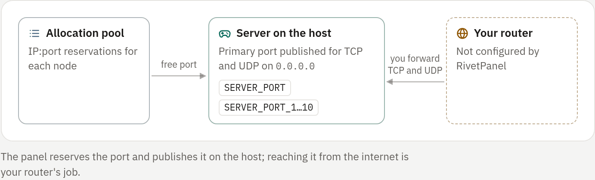

## Allocations

An allocation is an IP:port reservation on a node. Each server has a
**primary** allocation: it is published for TCP and UDP and passed to the
server as `SERVER_PORT`. Extra allocations are for plugins such as voice chat
or web maps, and reach the server as `SERVER_PORT_1` … `SERVER_PORT_10`.

A server can have at most 11 allocations [enforced: panel].

<!-- figure: game-ports -->

### How a new server gets its port

New servers take a free port from the node's pool under
**Administration → Allocations**. When the pool is empty, the panel picks the
next free port starting at the type's default port and adds it to the pool.

| Type | Default port |
|---|---|
| Minecraft types | 25565 |
| Velocity | 25577 |
| Valheim | 2456 (with the next port) |
| Rust | 28015 (plus a query port) |
| Project Zomboid | 16261 (with the next port) |

A port is free when no other allocation, published bot port or other program
on the host uses it. Ports that any running Docker container on the node
publishes are skipped too, pool ports included: another panel with its own
database, or any other tool. This holds even when Docker publishes a port only
with firewall rules, so that a bind test would pass. [enforced: panel]

The panel asks the Docker API on its own node, and the agent's port probe on
remote nodes. When no free port is left, the request is refused with a
message.

### Manage a server's ports

On the server's **Network** tab, owners and people with full control add
ports, choose the primary one with
**Make primary** and remove extras. The server must be stopped
[enforced: panel].

## Connecting players

The **Connect** block at the top of the **Overview** tab's side column shows
the address players type into the game, with a copy button and a one-line
hint for the game. The servers list and the header strip use the same address.

The host is resolved in this order:

1. the primary allocation's alias (**Administration → Allocations**)
2. the IP the allocation is bound to
3. the node's **Public address** (**Administration → Nodes**; the local node
   has one too)
4. the node's own IP when the panel knows it: the address a remote node's
   agent connects from, or the host of `RIVET_AGENT_ADDRESS` for the local
   node

The port is left out when it is the game's default (25565 for Minecraft Java).
Copying always gives `host:port`. Games with a separate query port (Valheim,
Rust) also show it.

Without any address, the block shows the port and asks an administrator to set
one. When the result is `localhost`, a loopback or a private (LAN) address,
the block says that only this machine or the local network can use it.

### Give players a name

The panel's own host name is never shown to players and is refused as a public
address [enforced: panel]. It is for operators, and a name proxied by
Cloudflare does not carry game traffic.

1. Create a **DNS-only** (not proxied) record, such as `play.example.com`,
   pointing at the node's IP.
2. Enter it as the node's **Public address** under **Administration → Nodes**,
   or as an allocation's alias.

`GET /api/v1/game-hosts` exposes only the nodes' player addresses.

## Port forwarding

RivetPanel does not configure your router or firewall. To reach a server from
the internet, forward its primary port (TCP and UDP) on your router to the
host.

Published ports bind on the allocation's address, `0.0.0.0` by default, so the
server is reachable from every network the host is on.

## Port already used by another container

Starting a server whose port another container holds is refused, not counted
as a crash:

> Port 25565 is already used by another container on this host. Choose
> another port in Network, or ask an administrator to free it.

If the port is taken between allocation and start, the runner records the same
message, also when Docker answers "port is already allocated" or "address
already in use". The server then shows **Port in use** and:

- is not restarted automatically
- does not add to the crash count
- sends no crash notification

On the **Overview** tab, an owner or someone with full control can choose:

- **Pick a free port**: moves the primary allocation to the next free port of
  the node, returns the busy one to the pool, and starts the server again if
  it was meant to run.
- **Start again**: retries the same port.

> [!NOTE]
> The other container can belong to another account, so its name is shown
> only to administrators (accounts with `allocations.manage`, `nodes.manage` or
> `system.view`): when they start the server, in the allocation lists and in
> the panel log. It is never stored in the server's error.

## The allocation pool (administrators)

Under **Administration → Allocations**, administrators:

- add ranges, such as `25565-25600, 19132`
- set the address players see, such as `play.example.com`
- delete free ports

Ports already in use on the host are skipped and listed with the container
that holds them. Adding only busy ports is refused.

On a remote node, the node's agent checks that a port can be bound before it
is allocated automatically or the server starts. This is a check, not a
reservation. See [Remote nodes](../07-operate/04-remote-nodes.md).
