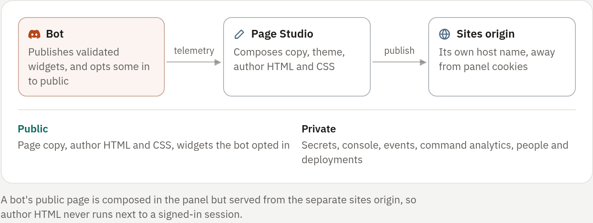

## Kinds of site

RivetPanel hosts websites next to your bots, in three kinds:

| Kind | What is served |
|---|---|
| Static files | HTML, CSS, JavaScript and images served exactly as uploaded, edited in the panel, or taken from a GitHub branch |
| Static build | A GitHub repository built on the server on every push (`npm run build` for Vite, SvelteKit, Astro, Next.js export, Nuxt generate…); the output folder is published |
| App | A server process from a GitHub repository (Node.js and TypeScript, PHP and Laravel, Python, Go, Rust) that runs in a container and receives every request for the site's addresses, with variables, a persistent `/data` folder, optional databases and logs |

All three get the same addresses, custom domains and access rules. Builds and
apps are covered in [Sites from GitHub](02-from-github.md). This page covers a
bot's own site and how every site is served.

## A bot's public page

Every Discord bot can own one site directly. Open the bot's **Public page**
tab to create its integrated site and open Page Studio. Links to the bot's old
**Analytics** tab open it too.

The tab has three views:

| View | What it is for |
|---|---|
| **Page studio** | Design the generated page, or switch to custom files |
| **Site files** | The private draft of custom files (developers and up) |
| **Private insights** | The bot's private telemetry, never published |

**Address, domains & releases** opens the site's own page, to change the
address and for DNS, GitHub deployments, ZIP uploads, rollback and settings.
**Open page** opens the live page.

### Generated page or custom files

The same address serves one of two modes. Switching never removes the
generated-page settings or the file releases, and the domains and public
address stay the same.

- **Generated page** publishes from structured settings when you press
  **Save and publish**: headline, introduction, theme (Midnight, Daylight or
  the visitor's system), accent color, a custom HTML section, custom CSS, and
  optional bot widgets. An isolated live preview shows the result.
- **Custom files** serves an immutable release of HTML, CSS, JavaScript,
  images and other static assets. **Site files** is a private working draft
  with the same explorer and conflict-aware editor as bot files. Saving never
  changes the live site; **Publish draft** snapshots and activates it. See
  [Publishing](03-publishing.md).

### Bot widgets on the page

A generated page can show validated, declarative bot widgets, but only after a
developer turns on **Publish bot widgets**. It is off by default.

Turning it on publishes only each widget's title, layout and validated
payload. The public page response never contains raw stat series, command
names or counts, events, console output, logs, environment variables or
secrets, the owner's email or identity, workspace membership, or deployment
details [enforced: panel]. See [Widgets](../05-observe/01-widgets.md).

Custom CSS can target one widget with `[data-widget="latency"]`, or every
renderer of a kind with `.kind-metric`. The page exposes `--accent`.

### Custom code runs only on the sites origin

Custom HTML, CSS and scripts are powerful and are treated as author code. They
run only on the separate sites origin described below, including inside Page
Studio's cross-origin preview. They never execute in the signed-in panel
[enforced: panel].

## How sites are served

Sites are served by a separate listener (`RIVET_SITES_LISTEN`) that never
serves the panel, and always on different host names from the panel
[enforced: panel]. Site files are arbitrary user HTML and scripts. On the
panel's origin they could read CSRF tokens, register service workers or act as
the signed-in user; on their own host names they cannot.

- A site's default address is `<slug>.<sites domain>`, such as
  `https://docs.sites.example.com`. See [Domains](04-domains.md).
- A site can also answer on verified custom domains.
- The listener maps the request's `Host` to the site's current **release** and
  serves files from that release's directory through a descriptor-contained
  root. Paths cannot leave the release, and symlinks cannot point outside it
  [enforced: panel].
- Dot-files and dot-directories (`.env`, `.git/`, …) are never served, even if
  uploaded; `.well-known/` is the exception [enforced: panel].

<!-- figure: sites-flow -->

### Static responses

Static sites answer `GET` and `HEAD` only. Conditional and range requests are
supported.

| Files | Caching |
|---|---|
| HTML | `Cache-Control: no-cache`, so a new release shows immediately |
| Fingerprinted build output (`_app/immutable/`, `_astro/`, `_next/static/`, `_nuxt/`, and hash-named files under `assets/` such as `index-B4x9kQ2a.js`) | A year, as `immutable` |
| Everything else | An hour, then served stale for up to a day while it revalidates |

A `_headers` file can override all of this; see
[Redirects and headers](05-redirects-and-headers.md).

Text files (HTML, CSS, JavaScript, JSON, SVG, fonts…) of 1 KiB or more are
gzipped when a release is published and sent compressed to browsers that
accept it. `.br` and `.gz` files shipped next to the original (SvelteKit's
`precompress`, Vite compression plugins) are preferred, brotli first.

### Options for custom-file sites

| Option | Effect |
|---|---|
| Single-page application | Unknown paths serve `/index.html` |
| Clean URLs (on by default) | `/about` serves `about.html` or `about/index.html` |

A `404.html` at the top level is used for missing pages.

### Keep sites on their own domain

> [!IMPORTANT]
> Use a separate registrable domain for sites, the way GitHub uses `github.io`
> next to `github.com`; for example `example-sites.net`. A sites domain that
> only shares a parent with the panel (panel `panel.example.com`, sites
> `sites.example.com`) works, but sites could then set cookies for
> `example.com`.

RivetPanel refuses configurations where the panel's host would be a site host
name, and in production refuses a panel host equal to the sites domain
[enforced: panel].
