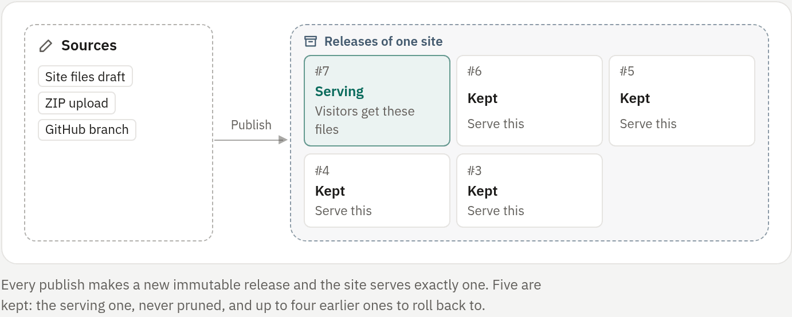

## Releases

Every publish creates a new immutable **release**, and a site serves exactly
one release at a time. Partial edits never reach visitors.

Five releases are kept per site: the serving one, which is never pruned, and up
to four earlier ones for rollback.

<!-- figure: site-releases -->

A release can be at most `RIVET_SITE_MAX_BYTES` uncompressed, 100 MiB by
default [enforced: panel]. See [Domains and configuration](04-domains.md#configuration).

## Create a site

**New → Website** offers three starts:

| Option | What you get |
|---|---|
| **Upload files** | An empty site, or one started from a template, that you fill from a ZIP or the editor |
| **From GitHub** | A static site, static build or app from a repository; see [Sites from GitHub](02-from-github.md) |
| **From a template** | The **Templates → Websites** gallery |

Each asks for the name, address and workspace. Creating a site needs the
`sites.create` permission [enforced: panel].

### Start from a template

Instead of starting empty, pick a built-in starter. The template's files, with
the site name filled in, become the first release, so the site is live at
once. Edit them afterwards in the draft editor, or replace them with an
upload.

- **Landing page**
- **Docs and blog**: several linked pages and a shared stylesheet
- **Portfolio**
- **Coming soon**
- **Game server community**: with a status section for this panel (below)

The templates are written for RivetPanel and embedded in the binary, a few KiB
each.

1. Open **Templates → Websites** to browse them with a framed preview that runs
   no scripts. In **Upload files**, the **Start from** field offers the same
   templates, and Go to has a **New site from …** entry for each.
2. Press **Create site** and enter the name, address and workspace.

Templates count against the site size limit like any release. Administrators
cannot add their own templates yet.

The **Game server community** template reads this panel's public status page
(`GET /api/v1/status`, which allows any origin to read it). It shows live
state only when the status page is enabled and the panel is reachable over
HTTPS from visitors, because the sites CSP allows `https:` connections.
Otherwise it falls back to a link.

## Publish files

### Site files

**Site files** is a private draft editor. Saving never changes the live site.

1. Edit, upload or move files in the draft.
2. Press **Publish draft**. The draft is snapshotted and becomes the serving
   release.

### ZIP upload

Drag and drop an archive on the site page, or send it as the body of
`POST /api/v1/sites/{id}/upload`.

- A single top-level folder such as `dist/` is unwrapped.
- The archive is validated and extracted with the same hardened extractor as
  bot uploads: no links, no special files, size and entry limits
  [enforced: panel]. A rejected archive changes nothing.
- The compressed size is bounded by `RIVET_MAX_UPLOAD_BYTES`
  [enforced: panel].

### A GitHub branch, as it is

On the site page of an uploaded site, link a repository, branch and optional
folder, then press **Deploy latest commit**. The branch should contain built
files, for example `gh-pages` or a `dist` folder committed by CI. To build on
the server instead, create the site with **From GitHub**.

Public repositories work without a connected account. Private ones use the
GitHub access of the member who linked the repository. The tarball is
downloaded through the GitHub API, as for bots, and nothing from the
repository runs.

## Roll back

On the site page, press **Serve this** on an earlier release. Visitors get
those files immediately.

Apps from GitHub have no file releases: they roll back by deploying an earlier
commit. See [Sites from GitHub](02-from-github.md#rolling-back).

## Backups of uploaded sites

Sites made from uploaded or edited files have a **Backups** card on the site
page:

- The published files are archived on the backup schedule when they changed,
  or on demand.
- Site admins can turn **Automatic backups** on or off. They are on by
  default; turning them off keeps the existing backups.
- **Restore** publishes a backup as a new release.

Sites from GitHub use the **Backups** tab instead; see
[The site page](02-from-github.md#the-site-page).
