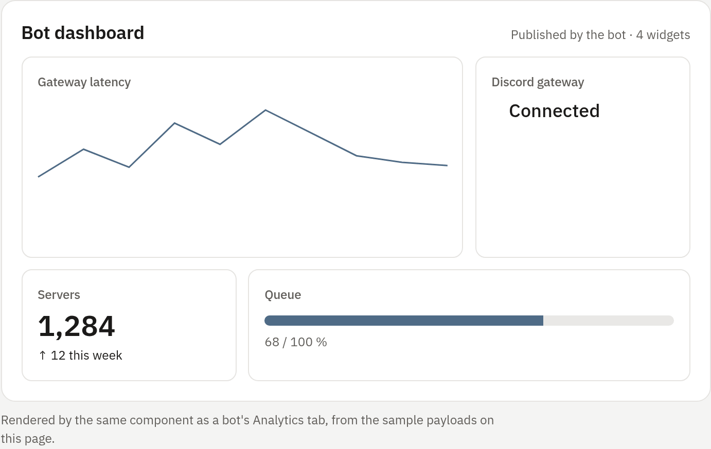

## What widgets are

A bot can publish a dashboard made of declarative widgets: a metric, a status
light, a chart, a table and so on. The bot sends plain JSON and the panel draws
known elements from it, so the same payload works from Node.js, Python, Go,
Rust, Java and Ruby.

Bot code cannot put HTML, scripts, CSS or iframes into an operator's browser.
The panel only renders validated widget data. [enforced: panel]

<!-- figure: widget-sample -->


The dashboard appears on the bot's **Public page → Private insights**, which
only people with access to the bot can open. Widgets reach the public page
only when you publish them (see [Publish widgets on the public
page](#publish-widgets-on-the-public-page)).

## Send widgets

Widgets travel in the same telemetry push as the bot's stats, either
`POST /api/v1/bot-telemetry` or the WebSocket at `/api/v1/bot-telemetry/ws`.
Each shipped SDK has a `widget` (or `SetWidget`) method for this; setting up
the key and SDK is covered in [Bot telemetry](03-telemetry.md).

```json
{
  "ready": true,
  "widgets": [
    {"key":"shards","kind":"metric","title":"Shards","group":"Overview","position":10,"data":{"value":4,"unit":"online"}},
    {"key":"latency","kind":"line","title":"Gateway latency","group":"Operations","span":2,"position":20,"ttl_seconds":120,"data":{"unit":"ms","points":[{"label":"now","value":42}]}},
    {"key":"gateway","kind":"status","title":"Gateway","group":"Operations","position":30,"data":{"state":"good","text":"Connected"}}
  ]
}
```

Widgets are stored by `key`: a widget with a key that already exists replaces
the previous one. One push can change up to 48 widgets, and the dashboard shows
up to 240 active widgets, in tabs by `group` and ordered by `position`.

### Widget fields

| Field | Required | Rules |
|---|---|---|
| `key` | Yes | 1–64 letters, numbers, spaces, dots, colons, underscores or hyphens; once per push |
| `kind` | Yes | One of the 18 kinds in [Widget data shapes](02-widget-data.md) |
| `title` | Yes | 1–80 characters |
| `data` | Yes | A JSON object, not `null`, at most 4096 bytes, in the shape its kind needs |
| `group` | No | The tab name, up to 48 characters; `Overview` when left out |
| `span` | No | Columns the widget takes: `1`, `2` or `3` (default 1) |
| `min_height` | No | 0–800 pixels |
| `position` | No | 0–1000; lower comes first |
| `ttl_seconds` | No | 30 seconds to 7 days (604800); the widget expires if it is not refreshed in time |

All of these are checked on every push. [enforced: panel] An invalid widget
rejects the push, and the error names the offending widget and field.

### Refresh and staleness

Widgets share the bot's telemetry limits: 60 pushes a minute and 64 KiB per
push (see [Bot telemetry](03-telemetry.md#limits)). Update widgets every 10–30
seconds.

A widget that has not been refreshed for five minutes shows a **Stale** badge.
It stays on the dashboard until it expires (`ttl_seconds`) or is removed.

## Remove widgets

- **From the bot:** list keys under `unpublish` in the next push, up to 48 per
  push. A key cannot be published and unpublished in the same push.

  ```json
  {"unpublish":["queue","old-chart"]}
  ```

- **From the panel:** a full administrator of the bot can remove a widget from
  the dashboard, or call `DELETE /api/v1/bots/{bot_id}/widgets/{widget_key}`.
  The bot can publish it again in a later push.
- **By expiry:** a widget with `ttl_seconds` disappears when it is not
  refreshed in time.

## Publish widgets on the public page

Widgets stay private until a developer turns on **Publish bot widgets** in the
bot's **Public page → Page Studio**. The switch exposes the validated widgets
only. Raw stats, command usage, events, console output, logs and bot
configuration stay private. [enforced: panel]

Turn **Publish bot widgets** off to remove every widget from the public page at
once.

### Style published widgets

The public page gives every widget two styling hooks: `[data-widget="KEY"]` for
one widget, and a renderer class such as `.kind-metric` for every widget of a
kind. The page also exposes the `--accent` color. Add rules under Page Studio's
**Custom CSS**:

```css
/* One widget, by its key. */
[data-widget="latency"] {
  grid-column: span 2;
  border-color: var(--accent);
}

/* Every metric widget. */
.kind-metric .metric {
  font-variant-numeric: tabular-nums;
}
```

For larger compositions, use Page Studio's custom HTML section or switch the
site to custom files (see [Bot sites](../04-websites/01-bot-sites.md)). Author
HTML, CSS and scripts run on the separate Sites origin and are never injected
into the panel. [enforced: panel]

## Why widgets are declarative

The panel uses a fixed widget schema instead of embedded webviews or arbitrary
HTML. The schema works the same in every language, survives panel theme
changes, works on phones, and keeps untrusted bot output out of the panel's
pages.
