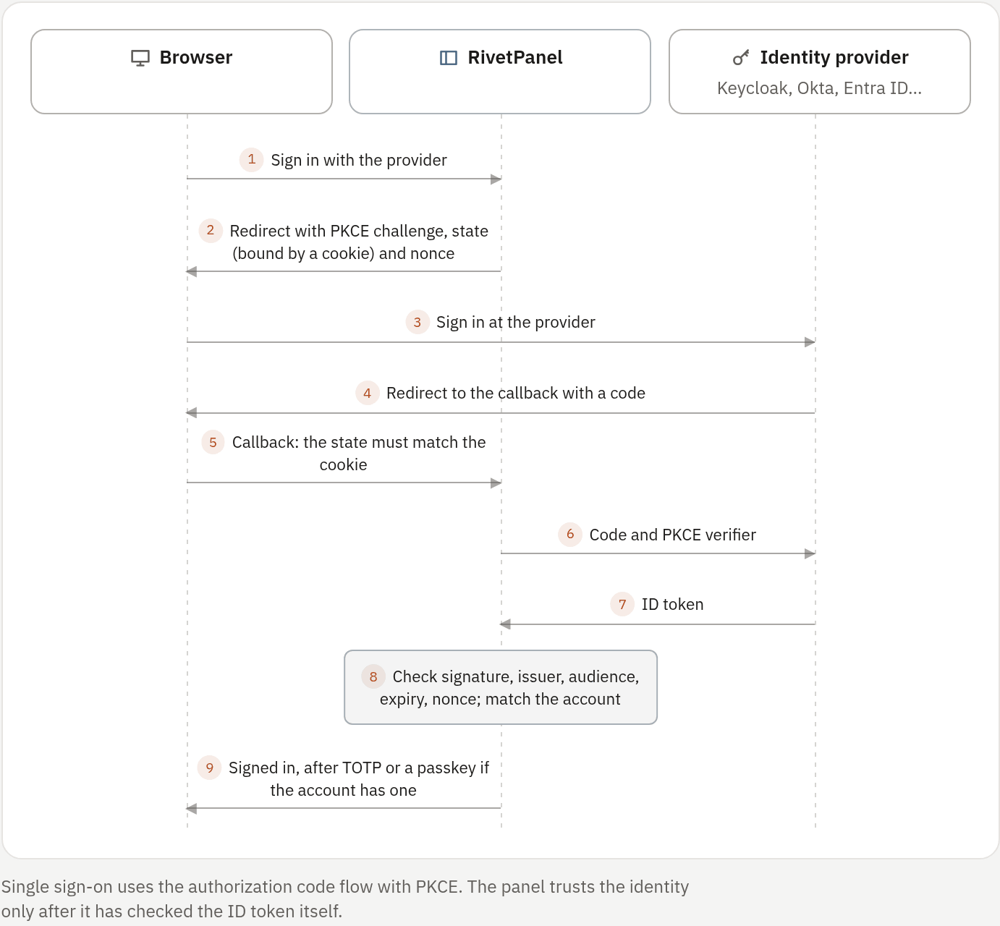

## Ways to sign in

| Method | Set up by | Notes |
|---|---|---|
| Email and password | Everyone | Always available. Passwords are hashed with Argon2id |
| GitHub, Discord | An administrator enables the provider; you connect it | See [GitHub and Discord](#github-and-discord) |
| Single sign-on (OpenID Connect) | An administrator adds the provider | Keycloak, Authentik, Okta, Microsoft Entra ID, Google and others |
| Passkey | You, under **Settings → Security** | No password and no code needed |

Two-step sign-in, when on, applies after a password and after a provider
sign-in. A disabled account cannot sign in by any method.

## Your account

### Password and sessions

- Changing your password signs out your other sessions.
- **Settings → Security** lists your sessions and signs any of them out. An
  account keeps at most 20 sessions. [enforced: panel]
- With email set up, a forgotten password can be reset from the sign-in page
  through an emailed one-use link (see [Email](../07-operate/06-email.md)).
- Every password or two-step change sends a security notice by email.
- On the host, `rivetpanel reset-password EMAIL` is the recovery path.

### Two-step sign-in

Set up two-step sign-in (TOTP) under **Settings → Security** with any
authenticator app:

1. Enter the key shown in your authenticator app, or open the `otpauth://`
   link on a phone.
2. Confirm with a first code.
3. Store the 10 one-use recovery codes. Only their hashes are kept.

Codes cannot be replayed, and one sign-in allows 5 attempts in 5 minutes.
[enforced: panel] With two-step sign-in on, SFTP no longer accepts the account
password; use SFTP keys. On the host, `rivetpanel reset-mfa EMAIL` removes
two-step sign-in from an account.

### Passkeys

**Settings → Security → Passkeys** adds WebAuthn passkeys. Adding one needs
your current password (or, without one, a sign-in within the last 10 minutes).
Rename and remove passkeys on the same page.

- **Sign in with a passkey** on the sign-in page needs no email, password or
  code. The browser offers this panel's passkeys. A passkey with user
  verification is already two factors, so no TOTP code follows.
- **As the second step:** with two-step sign-in on, **Use a passkey instead**
  replaces the code. Only a passkey of the account that passed the first step
  is accepted.

The panel stores only the public key, the sign counter and flags; the private
key never leaves the authenticator. It checks the signature, challenge,
origin, relying party, user verification and counter. [enforced: panel] A
counter that goes backwards (a possibly cloned authenticator) is refused.

> [!NOTE]
> Passkeys need the panel address to be a host name. They are unavailable until
> the address is set, or when it is an IP address (browsers refuse those), and
> existing passkeys stop working if the host name changes.

### Connected accounts

**Settings → Connected accounts** connects GitHub, Discord and single sign-on
providers to your account. A connected identity then signs you in.

- An account cannot remove its last sign-in method; a password counts as one.
  [enforced: panel]
- Connecting Discord with **Enable notifications** sends your app alerts to a
  Discord channel (see [Notifications](../05-observe/07-notifications.md)).
- GitHub asks for `read:user user:email` to sign in. It asks for the `repo`
  scope only when you choose **Grant repository access**, which deploying
  private repositories and adding the push webhook need.
- Discord asks for `identify email`, plus `webhook.incoming` only when you
  choose **Enable notifications**.
- The GitHub access token and the Discord webhook URL are encrypted with the
  panel's key (`RIVET_KEY_DIR`); Discord's access token is not stored.
  Encryption does not hide them from someone with root on the host.

## API clients

API clients are bearer tokens (`rvc_…`) for programs that need the same API the
panel uses. The narrower automation tokens are covered in [Automation
API](../07-operate/11-automation-api.md).

1. Open **Settings → SFTP and API keys → API clients** (permission
   `api_keys.manage`).
2. Choose the permissions, optionally the bots and workspaces it may reach, and
   an expiry.
3. Copy the token. It is shown once; only its SHA-256 is stored.

```sh
curl -H "Authorization: Bearer $RIVET_CLIENT" https://panel.example.com/api/v1/bots
```

| Rule | Detail |
|---|---|
| Permissions | Chosen from the [role catalog](02-roles-and-permissions.md#permission-catalog), only those you hold now. Every request intersects the client's list with your *current* role, so a role change applies at once [enforced: panel] |
| Never an administrator | A client made by an administrator does not act as one: no environment editor, modules, other accounts' apps or making administrators. It holds only the administration permissions it carries, under the delegated-administration rules [enforced: panel] |
| Reach | Optionally limited to some bots and workspaces (every bot in a listed workspace). A limited client gets `403` for other bots and workspaces, creating workspaces, creating bots outside a listed workspace, moving a bot out, the administration area, sites, account-wide activity and the AI assistant. Bot and workspace lists are filtered [enforced: panel] |
| Session-only actions | No client can manage passwords, two-step sign-in, passkeys, sessions, linked accounts, SFTP keys, automation tokens or API clients, change the profile or address, accept invitations or sign out [enforced: panel] |
| Expiry | 1 to 366 days, or never |
| Rate | 600 requests per minute per client [enforced: panel] |
| Last use | Recorded to the minute |

Revoke a client yourself, or an account manager revokes it under
**Administration → API clients** (`users.view` to list, `users.manage` to
revoke; a delegated manager only for accounts it outranks). Revocation, expiry,
a disabled owner and role changes apply on the next request; nothing is
cached.

The activity log records creation (name and permissions), revocation, changes
made with a client (the actor reads "email via API client NAME") and every
refused change outside the client's scope (`account.api_client_refused`).

Permissions use the same route checks and service checks as browser sessions.
The bot and workspace limits are checked in the authentication middleware and
again in the bot and workspace services.

## Invitations

*Needs `users.manage`.* **Administration → Users → Invite user** creates a
one-use link that registers one account, optionally locked to an email
address. With email set up, the panel can email it. Besides the address, an
invitation sets up the account:

| Setting | Needs | Notes |
|---|---|---|
| Role | `users.manage` | User, a custom role, or Administrator (built-in administrators only). A delegated manager can only hand out roles whose permissions it holds |
| Limits | Built-in administrator | An allowance for the invitee's personal workspace, as under **Administration → Workspaces** |
| Node | `nodes.manage` | Pins the personal workspace's new apps to a node that accepts apps |
| Team workspace and role | Administering that workspace | The invitee joins it as admin, developer or viewer |
| Expiry | `users.manage` | 1 to 30 days (the form offers a few) |

The setup is applied in the same database transaction that creates the
account, so a half-set-up account never exists. [enforced: panel] A role, node
or workspace deleted between the invitation and its use is skipped; the account
is still created. Links made before invitations carried a setup keep working
and carry none.

- Pending invitations are listed on the **Users** page with their setup and
  creator, and can be revoked.
- The register page shows the role and the workspace being joined before the
  invitee chooses a password, and the invitation email says the same.
  `POST /api/v1/registration/preview` returns only `role_name` and
  `workspace_name` next to the address, never limits or nodes.
- Creating and revoking invitations and registering from one are in the
  activity log (`admin.invite_create`, `admin.invite_revoke`,
  `account.register`).

API: `GET` and `POST /api/v1/admin/account-invites` (`POST` takes `email`,
`role`, `expires_in_days`, `send_email`, `quota`, `node_id`, `workspace_id`,
`workspace_role`) and `DELETE /api/v1/admin/account-invites/{id}`.

## GitHub and Discord

### How provider sign-in behaves

- A linked GitHub or Discord identity signs in to its account.
- **No merging by email.** A provider sign-in never attaches to an existing
  account because the addresses match. Sign in with your password first, then
  connect the provider. [enforced: panel]
- New accounts from a provider are off by default. With **Registration** on
  (below), an unknown identity with a *verified* email creates a normal user
  account.

### Set up GitHub and Discord sign-in

*Administrators, with `settings.manage`.* Every installation registers its own
OAuth apps; credentials are never shared between installations.

1. **Set the panel address** under **Administration → Panel settings → Panel
   address** (or `RIVET_PUBLIC_URL`). It is the exact origin people open:
   scheme, host and a non-default port, with no path and no trailing slash. It
   must use `https://`; plain `http://` is accepted only for `localhost` and
   loopback. The callback URLs are built from it:

   ```text
   <panel address>/api/v1/auth/github/callback
   <panel address>/api/v1/auth/discord/callback
   ```

2. **Register a GitHub OAuth App** (not a GitHub App) under GitHub → your avatar
   → **Settings → Developer settings → OAuth Apps → New OAuth App**, or under
   an organization's **Settings → Developer settings**:

   | Field | Value |
   |---|---|
   | Application name | For example `RivetPanel (panel.example.com)`; people see it on the consent screen |
   | Homepage URL | Your panel address |
   | Application description | Optional |
   | Authorization callback URL | `https://panel.example.com/api/v1/auth/github/callback` |
   | Enable Device Flow | Leave unchecked |

   Register it, copy the **Client ID**, then **Generate a new client secret** and
   copy it at once; GitHub shows it only once. An OAuth App has a single
   callback URL, so register separate apps for local development
   (`http://localhost:8080/…`) and production.

3. **Register a Discord application** at the Discord Developer Portal → **New
   Application**. Name it, for example, `RivetPanel` (Discord refuses names
   containing "discord"). Under **OAuth2**, copy the **Client ID**, choose
   **Reset Secret** and copy the secret at once. Under **Redirects**, add
   `https://panel.example.com/api/v1/auth/discord/callback` and save. No bot
   user, intents or permissions are needed.

4. **Enter the client ID and secret** under **Administration → Panel settings →
   Sign-in**, which also shows the callback address to register. Settings saved
   there apply without a restart. **Turn off** disables a provider.

5. **Allow sign-ups, if you want them,** with **Administration → Panel settings
   → Registration** (*Allow new accounts from invitations, GitHub, or
   Discord*). Turning it off stops every self-registration path; administrators
   can still create accounts.

A provider is enabled only when both its client ID and secret are set. When it
is, the panel logs `oauth provider enabled` with the exact `redirect_uri`, and
what you register with the provider must match it character for character.

#### Set them in the environment file instead

Values in `/etc/rivetpanel/rivetpanel.env` replace the panel's settings, and
the matching fields show read-only:

```sh
RIVET_PUBLIC_URL=https://panel.example.com
RIVET_GITHUB_CLIENT_ID=...
RIVET_GITHUB_CLIENT_SECRET=...
RIVET_DISCORD_CLIENT_ID=...
RIVET_DISCORD_CLIENT_SECRET=...
# RIVET_OAUTH_ALLOW_SIGNUP=1     # optional: new accounts from GitHub or Discord
RIVET_PROXY_HEADER=CF-Connecting-IP   # only behind Cloudflare or a proxy on this host
```

The file then holds secrets: keep it mode `0640`, group `rivetpanel`. Restart
(`systemctl restart rivetpanel`) and look for `oauth provider enabled` in the
journal. Startup fails with a clear message when only an ID or only a secret is
set, or when the address is malformed or not HTTPS.

#### First administrator

```sh
sudo -u rivetpanel rivetpanel create-admin you@example.com   # prompts for a password
```

Sign in with that password, open **Settings → Connected accounts**, and connect
GitHub or Discord. From then on the provider buttons on the sign-in page work.

#### Rotate a client secret

Generate a new secret at the provider and replace the old one where it is set:
**Panel settings**, or `rivetpanel.env` followed by a restart. People stay
signed in, and linked accounts are unaffected.

### Behind Cloudflare

WebSockets, which the live console uses, work through Cloudflare by default.

- **Cloudflare Tunnel (recommended; no inbound ports):** create a tunnel under
  **Zero Trust → Networks → Tunnels → Create a tunnel** (Cloudflared) and
  install `cloudflared` on the server with the command it shows. Add a public
  hostname with service type `HTTP` and URL `localhost:8080`; Cloudflare
  creates the proxied DNS record. Keep `RIVET_LISTEN=127.0.0.1:8080` and set
  `RIVET_PROXY_HEADER=CF-Connecting-IP`.
- **DNS record and a reverse proxy on the server:** add a proxied `A` (and
  `AAAA`) record pointing at the server, use SSL/TLS mode **Full (strict)**
  with a Cloudflare Origin Certificate or a Let's Encrypt certificate on the
  proxy, and set `RIVET_PROXY_HEADER=CF-Connecting-IP`. Firewall the origin so
  only Cloudflare and you can reach it. The panel trusts that header only from
  loopback, so the proxy must run on the same machine. [enforced: panel]

### Troubleshooting

| Symptom | Cause |
|---|---|
| The provider reports a `redirect_uri` mismatch or *Invalid OAuth2 redirect_uri* | The registered URL differs from the logged one (scheme, host, port, trailing slash) |
| No provider buttons on the sign-in page | Both the client ID and the secret must be set; look for `oauth provider enabled` in the log |
| `state_invalid` after returning from the provider | The flow is older than 10 minutes or was reused, or the browser blocked the `rivetpanel_oauth` cookie. A restart also drops pending flows |
| `signup_disabled` | The identity is not linked to any account and sign-ups are off; link it from Settings |
| `email_in_use` | An account with the provider's verified email already exists; sign in with the password and connect from Settings |
| `email_unverified` | The provider shared no verified email (GitHub: make a primary email verified) |
| `429` on sign-in | More than 30 attempts a minute from one address; behind a proxy, set `RIVET_PROXY_HEADER` |

## Single sign-on

*Administrators, with `settings.manage`.* **Administration → Single sign-on**
adds OpenID Connect providers such as Keycloak, Authentik, Okta, Microsoft
Entra ID or Google.

1. Set the panel address first (**Administration → Panel settings**). The
   callback URL is built from it, and sign-in buttons stay hidden without it.
2. Register a client at the provider with the redirect URI shown in the form:
   `https://<panel>/api/v1/auth/oidc/<url-name>/callback`.
3. Enter the issuer URL, the client ID and, for a confidential client, the
   secret. Leave the secret empty for a public client. Scopes always include
   `openid`; ask for `email` too.

When you save, the panel reads `/.well-known/openid-configuration` under the
issuer and refuses the provider if that fails. The issuer must use `https`;
plain `http` is accepted only for a provider on the same machine (`localhost`,
loopback). The secret is encrypted with the panel keyring and never shown
again.

### What the panel checks

<!-- figure: sso-flow -->


Sign-in uses the authorization code flow with PKCE (S256), a random `state`
bound to the browser by a cookie, and a random `nonce`. The ID token's
signature (against the issuer's published keys), issuer, audience (the client
ID) and expiry are verified, and the nonce must match. [enforced: panel] Any
failure ends on the sign-in page with "could not verify" and is logged, never
with secrets.

### How accounts are matched

In this order:

1. A provider subject (`sub`) already linked to an account signs that account
   in.
2. Otherwise, the identity links to the account with the same address and
   signs it in, but only when **Link to an existing account with the same
   address** is on, the provider says the address is verified
   (`email_verified: true`, or the string `"true"`), and the account holds no
   administration permission. [enforced: panel]
3. Otherwise, if an account with that address exists, sign-in is refused
   ("sign in another way, then connect the provider"). The owner signs in
   another way and links the provider under **Settings → Connected accounts →
   Single sign-on**. A link made from Settings joins the signed-in account
   whatever address the provider reports.
4. Otherwise, when **Create accounts for new people** is on, a passwordless
   account is created with the chosen role: the User role or a custom role,
   never Administrator. Its address counts as verified only when the provider
   said so; otherwise the unverified-email policy applies until the person
   confirms it.

Two-step sign-in still applies: an account with TOTP enters its code, or uses
a passkey, after the provider.

### Delegated administrators and removal

A delegated administrator with `settings.manage` can only choose a default role
whose permissions it holds (for the User role, the permissions currently
stored for it), and cannot edit a provider that already hands out more. A role
a provider uses cannot be deleted. [enforced: panel]

Removing a provider removes every link through it. Accounts whose only sign-in
method it was keep existing, and an account manager can send them a password
reset.

The provider's own policies (MFA, groups) are not read, and group-to-role
mapping is not implemented. [not enforced]

## Email for accounts

With email set up (see [Email](../07-operate/06-email.md)), people can reset a
forgotten password, administrators can email invitations, owners can get alerts
by email (the **Alert emails** switch in the profile), and every password or
two-step change sends a security notice. Administrators can also email news
and policy updates under **Administration → Announcements**.

Confirming an email address is covered in [Roles and
permissions](02-roles-and-permissions.md#email-verification).
