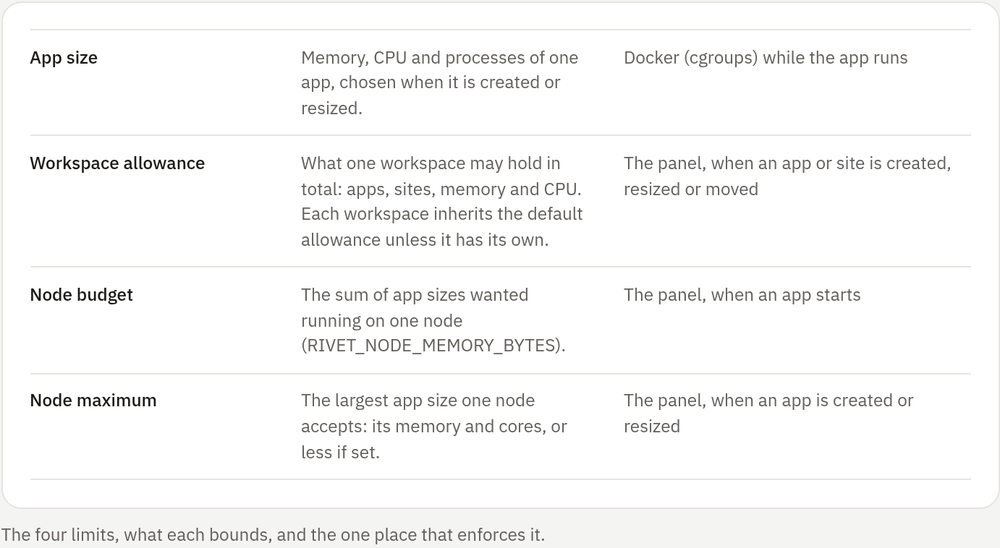

## Four kinds of limit

Four kinds of limit apply, and each is enforced in one place. An app's size is
a hard limit Docker puts on its container. [enforced: docker] Everything else
is an admission check by the panel when you create, resize, move or start
something. [enforced: panel]

<!-- figure: limits-legend -->

The panel-wide workspace allowance is called the **default allowance**. Disk is
not counted: there are no disk quotas. [not enforced] Retention and other caps,
such as the log archive size, backups kept and upload sizes, keep their own
names and are described with their features.

**Administration → Host → Capacity** lists every limit with the value in effect
now and where it comes from: Built-in, Environment, Environment page or Panel
default. The node maximum is shown as capped by the node's memory, and the
default allowance as Panel settings resolve it.

## Workspace allowance

Allowances belong to workspaces, not accounts. Every member's apps and sites in
a workspace count together, whoever created them.

### The default allowance

Every workspace inherits the default allowance from **Administration → Panel
settings → Default allowance** (`GET`/`PUT /api/v1/admin/limits`, audited as
`admin.limits`). A change applies at once, without a restart.

Where a field is empty there, an environment variable applies, else the
built-in value:

| Field | Environment fallback | Built-in |
|---|---|---|
| Apps in total | `RIVET_MAX_BOTS_PER_USER` | No limit |
| Sites | `RIVET_MAX_SITES_PER_USER` | 10 |
| Memory | `RIVET_USER_MEMORY_BYTES` | No limit |
| Everything else | None | No limit |

> [!NOTE]
> In the environment, 0 means no limit. On the panel's forms (the default
> allowance and a workspace's own allowance), 0 allows none.

Every value is shown with its source: Built-in, Environment, Panel default or
This workspace. `GET /api/v1/admin/limits` reports each value's `source` as
`panel`, `env` or `builtin`.

### One workspace's own allowance

*Built-in administrators only.* **Administration → Workspaces →** a workspace
**→ Workspace allowance** gives one workspace its own values
(`GET`/`PUT`/`DELETE /api/v1/admin/workspaces/{id}/quota`; reading needs View
workspaces). Each field replaces the default for that workspace only; an empty
field inherits the default, and 0 allows none. Values show their source
(`sources` in the API).

| Field | Counts |
|---|---|
| Apps in total | Bots and containers, game servers and web apps together |
| Bots and containers | Bots, container apps and each Compose service |
| Game servers | Game servers |
| Web apps | Web apps |
| Sites | Sites, including bot public pages and sites from GitHub |
| Memory | Memory sizes of all apps, add-on services included |
| CPU cores | CPU sizes of all apps |

Containers and Compose services have no count of their own: they count as
**Bots and containers**, and toward **Apps in total**. Every value that applies
must pass. For example, **Bots and containers** 1 with **Game servers**, **Web
apps** and **Sites** 0 lets a workspace hold a single bot or container and
nothing else.

The forms pick memory (256 MiB, 512 MiB, 1 to 32 GiB) and CPU (0.5 to 8 cores)
from presets, or take a custom value with a unit. Changes are in the activity
log (`admin.workspace_quota_set`, `admin.workspace_quota_clear`).

### When the allowance is checked

The panel checks the allowance at these moments. [enforced: panel]

- **Creating** a bot, game server, container, web app or site. The create and
  the check are one database transaction, so two requests at once cannot both
  take the last place.
- **Growing** memory or CPU: resizing, or adding an add-on.
- **Moving** an app or site (with its app) into another workspace.
- **Transferring** ownership: the app moves into the recipient's personal
  workspace.

Apps count until they are deleted, running or stopped, so starting an app
never needs an allowance check. A refusal names the workspace. Lowering an
allowance below what a workspace holds never stops or deletes anything; it
only refuses growth.

### Who is exempt

The exemption belongs to the account acting, never to a workspace. A built-in
administrator is never refused by a workspace allowance, wherever they create,
resize, move or transfer. Every other member is bounded, even in a workspace an
administrator owns. The node budget and node maximum apply to everyone.

`GET /api/v1/me/capacity` reports `exempt` for the calling account, together
with the workspace's allowance. The allowance views report no exemption.

### Team workspaces per account

Since every workspace inherits the default allowance, an account that owns
several team workspaces could hold several workspaces' worth. **Team workspaces
per account** (also under Default allowance; 20 when unset, 0 stops users from
creating team workspaces) bounds that. One account can hold up to that many
plus one (its personal workspace) times the default allowance, and the form
states that ceiling.

### What members see

Members see their workspace's usage and allowance under **Settings →
Workspaces →** the workspace. `GET /api/v1/me/capacity?workspace={id}` reports
them, or the caller's personal workspace without `workspace`.

## Room in the create forms

The bot, game server, container, Compose, site and new-site forms, and an app's
resource settings, name the workspace they create in and show what is left of
its allowance.

- Memory and CPU pickers stop at the smaller of the node maximum and that room.
  The help names the bound that applies, for example "Limited by the workspace
  memory allowance: 1.8 of 2 GiB used" or "Limited by the node maximum".
- An administrator sees the same room with "(you are exempt as an
  administrator)" and is bounded by the node maximum only.
- Creating is disabled when no room is left.
- When the new app's memory would not fit in the node budget left on its node
  (`node_budget` in `GET /api/v1/me/capacity?node={id}`), the form warns. The
  app is still created, but its start is refused until other apps stop.

The forms only show the limits beforehand; the server decides.

## Node budget and node maximum

*Set by administrators.* Host and node values are set in the environment file
or on the **Environment** page, and apply after a restart.

| Setting | Effect |
|---|---|
| `RIVET_MAX_BOT_MEMORY_BYTES`, `RIVET_MAX_BOT_NANO_CPUS` | Node maximum: the largest memory or CPU size of one app. Always capped by the node's own memory and core count, which alone apply when unset or 0 |
| `RIVET_NODE_MEMORY_BYTES` | Node budget: the sum of the memory sizes (add-ons included) of apps wanted running on a node. A start that would exceed it is refused (`409`) with the numbers. Unset or 0 is no limit |
| `RIVET_USER_MEMORY_BYTES`, `RIVET_MAX_BOTS_PER_USER`, `RIVET_MAX_SITES_PER_USER` | Fallbacks for the default allowance (see [above](#the-default-allowance)) |
| `RIVET_MAX_BUILDS` | Concurrent build containers (built-in 1); waiting builds say so |
| `RIVET_MIN_FREE_DISK_BYTES` | Free space that backups, restores and deployments need (built-in 1 GiB; 0 turns the check off) |

The node budget check and the start are one database transaction, so
simultaneous starts cannot overcommit a node. [enforced: panel] These are
admission rules, not kernel limits: containers still have their own hard
memory and CPU limits. [enforced: docker]

## Node placement

With [remote nodes](../07-operate/04-remote-nodes.md) enabled, a new bot or
game server goes to the first of these that applies:

1. The node chosen in the create form. Only accounts with `nodes.manage` may
   choose one; anyone may name this host.
2. The node its workspace is **pinned** to: **Administration → Workspaces →** a
   workspace **→ Node for new apps** (`PUT /api/v1/admin/workspaces/{id}/node`,
   `{"node_id": ""}` clears it; needs `nodes.manage`; audited as
   `admin.workspace_node`).
3. The panel's **default node**: **Administration → Nodes → Use for new apps**
   (`PUT /api/v1/nodes/default`; needs `nodes.manage`; audited as
   `admin.node_default`). Items from `GET /api/v1/nodes` carry `default`.
4. This host.

A pin or default only applies while its node still accepts new apps (enabled,
not draining); otherwise the next rule decides. Creating an app on a node whose
agent is offline is refused with a message naming the node. [enforced: panel]
Existing apps stay where they are, and web app units for sites always run on
this host.

The rules are a fixed order, not scheduling: nothing picks a node by free
memory or load.

### What people see

- Accounts that manage nodes see node cards in the bot and game server forms:
  location, local or remote, online state, host name, memory use, CPU, running
  apps, the per-app maximum, and **Default** and **Pinned** badges.
- Everyone else sees "Your apps run on …", from
  `GET /api/v1/placement?workspace=ID`. Any member of the workspace may call it,
  and it carries no telemetry or host names.
- An app's header shows its node's name to everyone with access to it.
