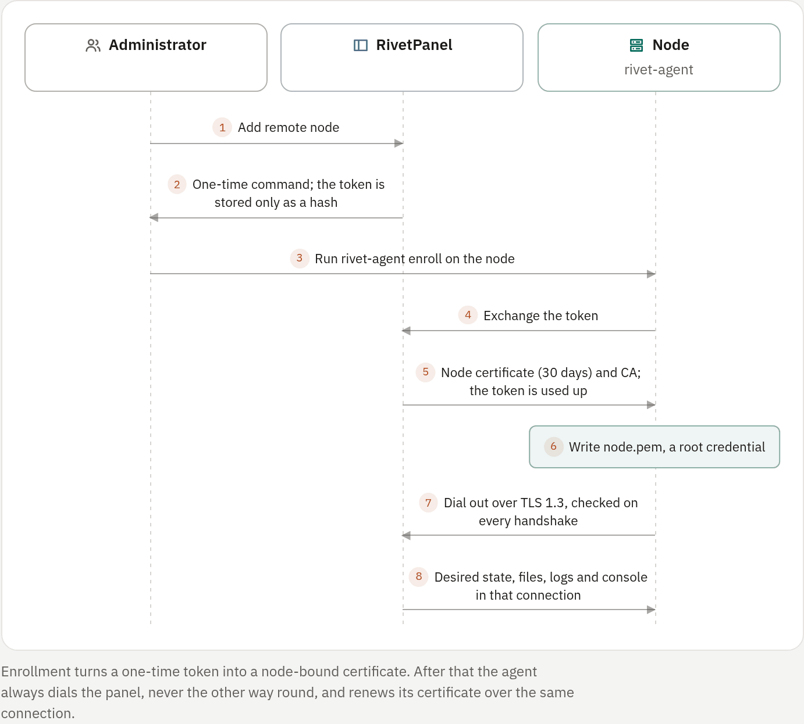

## What a node is

`rivet-agent` runs assigned bots and game servers on a separate Docker host.
It makes one outbound, mutually authenticated TLS connection to the panel, and
everything the panel does on the node travels over it: lifecycle, console,
resource samples, game status queries, backups, GitHub deployments and
publishing, the package manager, the AI assistant's file tools and
diagnostics, Files, SFTP, add-ons and node telemetry.

Remote nodes are a preview. They suit nodes you operate yourself; they are not
built for hostile node operators, and they do not make the panel unprivileged.
The panel still holds its local Docker socket when the local runner is on, and
each agent holds the Docker socket of its node. A Docker socket is
root-equivalent.

## Enable the agent listener

On the panel host, switch **Remote nodes** to Preview under
**Administration → Modules**, or set:

```ini
RIVET_MODULES=agents=preview,game_servers=preview
RIVET_AGENT_LISTEN=:8444
RIVET_AGENT_ADDRESS=panel.example.com:8444
RIVET_AGENT_HOSTS=panel.example.com
```

Restart RivetPanel and allow TCP port `8444` from the nodes. This is raw TLS
with a private agent protocol, not HTTP or WebSocket: never put it behind an
HTTP reverse proxy. `RIVET_AGENT_ADDRESS` is what agents dial; without it the
panel uses the public URL's host and the listener's port. `RIVET_AGENT_HOSTS`
lists the names and IPs in the listener certificate. With the container image,
publish port `8444` (commented out in `compose.yaml`).

The panel keeps an Ed25519 certificate authority under
`RIVET_KEY_DIR/agent-ca/`, created by `rivetpanel keygen`. Its private key can
mint node identities and is as sensitive as the encryption keys: never copy it
to a node. `rivetpanel backup --include-keys` includes it with manifest
checksums and `restore --restore-keys` restores it; start-up and backup refuse
a partial authority. [enforced: panel]

## Enroll a node

1. Build or unpack the release on the remote host and run
   `sudo deploy/install-agent.sh`.
2. In the panel, open **Administration → Nodes → Add remote node**, choose its
   location and copy the one-time command.
3. Run that command on the node:
   `sudo rivet-agent enroll --panel https://panel.example.com --token rvt_enroll_...`
4. Start the service: `sudo systemctl enable --now rivet-agent`, then check
   `sudo systemctl status rivet-agent`.

Enrollment writes `/var/lib/rivet-agent/node.pem` with the node's private key,
client certificate, CA certificate and connection address. Protect and back up
that file as a root credential.

The enrollment token is shown once and stored by the panel only as a SHA-256
hash. It is bound to its pre-created node and is valid for 15 minutes by
default (1 minute to 24 hours). A successful exchange consumes it in the same
database transaction that records the issued certificate. [enforced: panel]

<!-- figure: node-enrollment -->


### Enrollment from the shell

On the panel host, for recovery without the browser:

```sh
rivetpanel agent-token create --ttl 15m edge-one
rivetpanel agent-token list
rivetpanel agent-token revoke TOKEN_ID
rivetpanel agent-token reissue --ttl 15m NODE_ID
rivetpanel agent-token discard NODE_ID
```

`discard` is only for a node that never enrolled. To re-key an enrolled node,
revoke its certificate under **Administration → Nodes**, remove its old
`node.pem`, then use **Create enrollment** on the same node.

### Certificates

| Rule | Enforced |
| --- | --- |
| Certificates are node-bound, client-auth only and last 30 days | [enforced: panel] |
| TLS 1.3 requires a certificate chained to the private CA, whose serial is present, unexpired, unrevoked, assigned to that node and enabled | [enforced: panel] |
| Revocation is checked on every TLS handshake and disconnects the current session at once | [enforced: panel] |
| Every agent-to-panel server lookup is checked against the authenticated node, so a node cannot reach another node's servers | [enforced: panel] |

When an agent connects with less than a third of its certificate's lifetime
left, it renews over the authenticated connection, replaces `node.pem`
atomically and reconnects. The first successful handshake with the renewed
certificate revokes every older certificate of that node (reason
`superseded`), so a replaced `node.pem` cannot be reused. The old certificate
is not revoked when the renewal is issued, so an agent that stops before
saving its renewal can still reconnect with the old one and renew again.

### Agent configuration

`install-agent.sh` copies
[`deploy/systemd/rivet-agent.env.example`](../../../deploy/systemd/rivet-agent.env.example)
to `/etc/rivet-agent/rivet-agent.env` (mode `0640`) on first install:

| Variable | Default | Notes |
| --- | --- | --- |
| `RIVET_AGENT_DIR` | `/var/lib/rivet-agent` | Agent identity (`node.pem`) and enrollment state |
| `RIVET_AGENT_DATA` | `/var/lib/rivet-agent/servers` | Server workspaces; add-on data sits in an `addons` directory beside it |
| `RIVET_AGENT_DOCKER_HOST` | `unix:///var/run/docker.sock` | The node's Docker endpoint |
| `RIVET_AGENT_CONTAINER_USER` | `65532:65532` | Same rule as the panel; see [Workspace ownership](02-configuration.md#workspace-ownership) |
| `RIVET_AGENT_WORKSPACE_OWNER` | the container user | Host owner of workspace files |
| `RIVET_AGENT_NETWORK` | `bridge` | Docker network mode for the node's containers |

## Placement

Accounts that manage nodes (`nodes.manage`, built-in administrators included)
choose a node while creating an empty bot, a bot from a template, a bot from
GitHub or a game server. The three bot kinds need the node to be connected.

Everyone else's new apps follow a fixed order, and the create form says which
applies:

1. the node their workspace is pinned to
   (**Administration → Workspaces →** a workspace **→ Limits & placement**);
2. else the panel's default node (**Administration → Nodes → Use for new apps**);
3. else the panel's own host.

This is a fixed rule, not scheduling by free memory or load, and existing apps
never move. Creating an app on a node whose agent is offline is refused with a
message naming the node. Web app units for sites always run on the panel's own
host. The forms read `GET /api/v1/placement`: node managers see a card per
node, everyone else sees where their apps run. See also
[Limits and allowances](../06-teams/04-limits.md).

## Manage nodes

**Administration → Nodes** shows each node's connection state, agent version,
hostname, last contact, reported capabilities, certificate expiry and workload
count, with CPU, memory, disk and running-server charts for the last hour.

| Action | Effect |
| --- | --- |
| Drain | Refuses new placement; existing servers keep running. Nothing is migrated |
| Disable | Disconnects the agent |
| Revoke certificate | Disconnects the agent at once |
| Delete | Allowed only after every server on it has been removed or moved by an operator |

Accounts that manage nodes are notified when a node goes offline and comes
back.

### When a node goes offline

Desired state stays in the panel's database. The agent reconnects with
backoff, resynchronizes every assigned server and resumes reconciliation.
Server containers can keep running while the connection is down.

Until contact returns the panel marks live views unavailable: Files and the
package manager say the node is offline, an open console says so once and
resumes from the last line after reconnecting, and administrators see
"(node offline)" next to the node name on the server's page, where status and
stats are the last ones the node reported.

## What works on a node

Each feature below is refused while the node is offline unless the table says
otherwise.

| Feature | How it works remotely |
| --- | --- |
| Lifecycle, console, Files, live stats, game status | Routed over the agent connection |
| Console history | Copied into the panel's daily log files through the same authenticated console stream; nothing is stored on the node beyond Docker's 3 × 10 MB container logs. Output that rotated out while the node was offline is not captured |
| Backups | Manual, scheduled and pre-restore archives stream into the panel's backup directory. A restore is staged and journaled on the node until the panel confirms its database update |
| GitHub deployments | The panel downloads the repository (at most 1 GiB) and streams it to the node. Manual deploys to an offline node are refused; polling waits; a webhook push is remembered and deployed on reconnect |
| GitHub publish and push | The node selects the files under the same exclusions and limits as local publishing |
| Package manager | Edits the node's manifest with a revision check |
| AI assistant | File tools and diagnostics run against the node |
| Template bots | Created on the node in one transaction (node managers only) |
| Modrinth plugins and mods | Verified at the panel, then sent to the node |
| SFTP | Served through the agent |
| Services (add-ons) | Run on the node's Docker; states and logs come from the node |
| Automatic game ports | Probed on the node before they are allocated |
| Database browser | Not supported yet |

### Restores and deployments

A restore is staged and journaled on the node. The old workspace is released
only after the panel records its database update; an unconfirmed transaction
rolls back on timeout, or before the agent runner starts again after a
restart. [enforced: panel]

For a GitHub deployment the tarball is never unpacked on the panel host. The
agent unpacks and validates the whole archive into a private staging
directory. The panel then re-checks that the bot still exists and that its
repository link and node did not change, and only then lets the agent swap the
files. The previous files stay journaled until the panel has recorded the
commit: a database failure rolls them back, a confirmation that never arrives
rolls back after 5 minutes, and an agent crash is rolled back by the journal
at agent start.

A webhook push received while the node is offline is remembered, the newest
one per server, in the database so it survives a panel restart. It is deployed
once, at the branch head of that moment, when the agent reconnects. A push
whose repository link (name, branch, folder) or auto-deploy setting changed
meanwhile is dropped and shown as a cancelled deployment.

### Publishing to GitHub

The agent selects the files with the same `.gitignore`, built-in and `.env`
exclusions and the same limits as local publishing: 5,000 files, 200 MiB in
total and 25 MiB per file, which the agent refuses to exceed. The panel reads
only the selected files, one at a time, through the agent's contained file
API, builds the commit through the GitHub API and records it as deployed.
Nothing is written to the panel's disk. Offline nodes are refused before
anything is created.

### Package manager and AI file changes

The package manager lists the node's workspace root to pick the manifest,
reads it through the contained file API (1 MiB cap at the panel) and writes it
back with `If-Match` on the revision it read, or create-only when the manifest
is new. A concurrent change on the node makes the write fail with a conflict
and nothing is overwritten. The deployment and restore lock still blocks
edits. [enforced: panel]

The AI assistant's list, read and search tools use the same contained file
API. Protected paths are refused at the panel before any request, files over
1 MiB are skipped, a search reads at most 2,000 files, and secret values are
redacted at the panel before anything reaches the model. A proposed change or
Undo is sent as a revision-checked patch (`POST /node/v1/bots/:id/patch`); the
agent applies it through the same journal as restores and deployments and
keeps the previous file until the panel has recorded the change set. A stale
revision is refused without changing anything. An unconfirmed commit is
retried once and then rolled back; the node also rolls it back after 5
minutes, or at agent start after a crash.

### Template bots

A template bot on a node is refused before anything is recorded when the node
is offline or the template does not fit one patch: 32 files, 1 MiB per file,
8 MiB in total. Every built-in template fits. The panel records the bot, asks
the agent to create its directory (`POST /node/v1/workspaces/:id`) and sends
every template file as one create-only patch, which it commits as the last
creation step. If the patch is refused or its commit cannot be confirmed
(retried once, then rolled back), the bot is marked deleted and handed to the
agent's normal purge, which removes the directory and the row; an unreachable
agent does this when it reconnects.

### Modrinth downloads

The panel checks the person's file permission and refuses offline nodes
before downloading. It downloads the file into a private temporary file and
verifies the CDN host allowlist, the 256 MiB limit, the declared size and the
published SHA-512 over the complete file before any byte is sent.
[enforced: panel] The verified file is then streamed to the node with its
exact length; the agent writes it to a temporary file and renames it into
place, and the size it reports back must match. The temporary file on the
panel is removed as soon as the install ends.

Streaming the download straight through was rejected, because the node could
finish writing a file of the expected length before the checksum is known.
The node trusts the panel's verification and does not recompute the SHA-512.

### SFTP

Sign-in, the files permission (re-checked at least every 5 seconds, also for
open handles), the per-file size cap and the deployment/restore lock stay at
the panel; the agent never sees SFTP credentials. [enforced: panel] Every
operation uses the agent's file routes, so path containment is the node's
filesystem layer.

- A download is copied into a private, already-deleted temporary file on the
  panel before it is served. The panel's disk is never used to store a remote
  server's files.
- An upload is collected the same way and sent in one atomic write when the
  client closes the file. A write that keeps part of an existing file is sent
  with `If-Match` on its starting revision, so a concurrent change is refused.
- `remove` and `rmdir` use the agent's non-recursive delete: the node's own
  `rmdir` decides whether a directory is empty, so a file another session
  adds at that moment is never deleted with it.
- Listings show no modification times or permission bits.
- A server assigned to another node is never looked up on the panel's disk:
  it is refused while its node is offline and when the agents module is off.

### Services (add-ons)

All built-in kinds (PostgreSQL, Redis, MongoDB, MariaDB) run on the node's
Docker, in its private add-on network, with data in an `addons` directory next
to the agent's server directory. The panel needs no Docker runner of its own
for them.

- Services chosen while creating a server on a node are checked for that node
  before anything is saved.
- States and logs come from the node's Docker. The panel checks the person's
  permission and that the add-on is attached; the agent validates the server
  id, the add-on kind and the 1–500 line bound and returns at most 1 MiB. A
  node without a runner yet answers `503`.
- Removing a service deletes its data on the node, and attaching one again
  first clears leftovers there.

### AI diagnostics

Diagnostics run on the server's node. The panel keeps the permission check,
approvals, the per-run limit and secret redaction. The agent checks the
command against its own runtime allowlist, copies a safe snapshot of the files
(no secrets, symbolic links, `.git`, or large or binary files) into
`ai-scratch` next to its server directory, and runs the same offline container
as the panel: no network, 768 MiB memory, 1 CPU, 256 PIDs, 128 MiB tmpfs, the
agent's container user, a 10-minute timeout and 1 MiB of output.
[enforced: docker] A node runs at most two diagnostics at once. Snapshots are
removed after each run and at agent start; the agent's runner removes orphan
containers after 30 minutes.

### Free disk on the node

The node reports CPU, memory, load and the disk holding the agent's server
directory. The panel stores a sample per connected node every telemetry
interval for the Nodes charts and shows the node's free disk in a remote
server's live stats.

Before it stages anything on the node, the panel refuses the work when the
payload plus a 256 MiB margin would not fit [enforced: panel]:

| Payload | Size counted |
| --- | --- |
| Restore | Archive size |
| GitHub deployment | Unknown, so only the margin |
| AI change, template | Total size |
| Single file of 1 MiB or more (Modrinth, SFTP, large uploads) | File size |

This is a preflight, not a reservation: archives can expand and other writers
can fill the disk, in which case the node's write fails and the change is
rolled back. Telemetry is reported by the node and is never used for
authorization.

### Game server ports on a node

Before a game server on a node gets an automatic port, the agent binds and
immediately releases a TCP and a UDP socket on the allocation's address and
port (at most 64 ports per request) and says why a port is not free, such as
"already in use on the node" or "the address is not assigned on the node".
Busy ports are skipped, and a node that cannot answer refuses the allocation
instead of guessing.

Starting a stopped or failed remote game server probes its allocations first
and refuses the start, naming the port, when one is busy. If the node is
offline the start is recorded and the node reports the outcome. Free
allocations an administrator created in the pool are handed out without a
probe and checked at start.

> [!NOTE]
> A probe is a check, not a reservation. Another process can bind the port
> right after it, and Docker publishing a port only through firewall rules
> (userland proxy off) is invisible to a bind test, so the container start on
> the node can still fail.

## Protocol version

Panel and agent protocol versions must match exactly. This build speaks
protocol **8**; an agent of an older build is refused when it connects. A
protocol 7 agent is refused with "protocol 7 is not supported (this panel
speaks 8); update rivet-agent" and keeps retrying until it is upgraded. Upgrade
the panel and every `rivet-agent` together.

| Protocol | Added |
| --- | --- |
| 8 | Node-side port probe for game-server allocations and starts |
| 7 | Remote AI diagnostics, node telemetry and the free-disk check, non-recursive SFTP deletes, add-on data removal |
| 6 | Remote add-on states and logs |
| 5 | Remote AI file changes and package-manager revision checks |
| 4 | Remote GitHub publish and push |
| 3 | Remote GitHub deployment |

A mismatch is unsafe as well as refused: a protocol 6 agent would treat
SFTP's non-recursive delete as a recursive one.

## Enforcement and limits

Enforced on the node by Docker: container memory, CPU and PID limits, the
non-root user, dropped capabilities, the read-only runtime and
`no-new-privileges`. [enforced: docker] File paths and archive extraction are
contained by the agent's filesystem layer, and downloaded game files are
checked against their published checksums where the provider supplies them.
[enforced: panel]

Node capability and telemetry reports are evidence the agent sends and an
administrator reads. The panel does not attest the node independently or turn
a report into kernel or network enforcement. [not enforced]

Not implemented, or still local only:

- workload migration, scheduling by free memory or load, high availability,
  remote upgrades and certificate re-enrollment in place;
- disk quotas, IO throttling, bandwidth limits, egress allowlists, malware
  scanning, user namespaces and stronger sandbox runtimes [not enforced];
- the database browser for apps on nodes.

## Troubleshooting

On the node:

```sh
rivet-agent doctor
journalctl -u rivet-agent -f
```

Check that Docker is reachable, the state and data directories are writable,
the panel's HTTPS enrollment address is reachable, and outbound TCP to the
agent address and port is allowed. A revoked, expired, wrong-node or
disabled-node certificate is rejected at the TLS handshake. Reconnect attempts
back off instead of spinning while the panel is unavailable.
