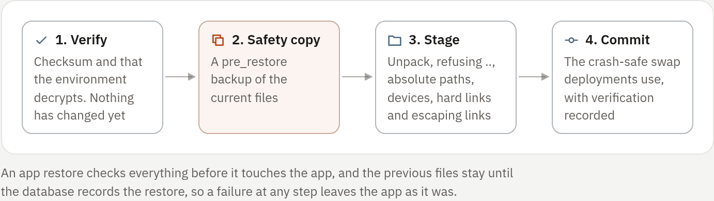

## Two kinds of backup

| | Installation backup | App backups |
| --- | --- | --- |
| Made by | `rivetpanel backup` on the host | Each app's **Backups** tab, a schedule, or the panel's interval |
| Holds | The database and every workspace on the panel host | One app's files, optionally its environment |
| Stored in | The directory you name | `RIVET_BACKUP_DIR` |
| Restores | The whole panel, while it is stopped | One app, from the panel |

Neither includes the other: installation backups do not contain
`RIVET_BACKUP_DIR`, and app backups do not contain the database or keys. Keep
both, and keep off-host copies: a backup on the same disk is not disaster
recovery.

> [!WARNING]
> Preserve the database, the workspace directory and the encryption keys
> together. Without the matching key files, sealed secrets (environment
> variables, OAuth tokens, webhook secrets) cannot be recovered. Store the
> keys separately from the database backups.

## Installation backup

```sh
rivetpanel backup /var/backups/rivetpanel/2026-09-30   # database and bot files
rivetpanel backup --include-keys DEST                  # also copy encryption keys
rivetpanel backup-verify DEST                          # checksums against the manifest
rivetpanel restore [--force] [--restore-keys] SRC      # the panel must be stopped
rivetpanel verify                                      # can every stored secret be decrypted?
```

The systemd install includes `rivetpanel-backup.timer`, which runs
`rivetpanel backup` daily at 03:30 (with up to 15 minutes of random delay)
into `/var/backups/rivetpanel/` and keeps the newest 14. It does not include
the keys.

A backup directory contains:

| File | Notes |
| --- | --- |
| `rivetpanel.db` | A `VACUUM INTO` snapshot, consistent including WAL contents. Never copy a live `.db` file by hand |
| `bots.tar.gz` | Every workspace on the panel host: regular files, directories, and symbolic links as links |
| `keys/` | Only with `--include-keys`, and then also the agent certificate authority. **Required to read environment variables**; store it apart from the database backup |
| `manifest.json` | SHA-256 of the database and archive, and the key ids in use |

Bot files are archived while bots may be running: stop them first for a
point-in-time copy. Container state and Docker logs are not backed up.
Extensions are stored in the database, so installed extensions are covered.

### What it leaves out

| Not included | Do this instead |
| --- | --- |
| App backups in `RIVET_BACKUP_DIR` | Back the directory up with your host backups |
| Site releases in `RIVET_SITES_DIR` | Back it up, or keep the built files to publish again. The database restores sites, domains and release history, but a site whose release directory is missing shows an "unavailable" page until it is published again |
| Workspaces on remote nodes | Use those servers' app backups, which stream into `RIVET_BACKUP_DIR` on the panel; keep off-host copies to survive losing a node |
| Encryption keys, by default | Add `--include-keys` and protect the result, or copy the key directory separately |

### Restore the installation

`rivetpanel restore` runs with the panel stopped. It:

1. verifies the checksums first;
2. refuses to overwrite an existing database or a non-empty data root without
   `--force` [enforced: panel];
3. extracts bot files relative to the data root: entry names must be
   `<uuid>/...`, nothing may traverse out, symbolic links are recreated but
   never followed, and setuid and setgid bits are dropped [enforced: panel];
4. writes the database last, atomically;
5. runs `verify`, which reports missing keys by id so you know exactly which
   key file to bring back.

`--restore-keys` also restores the keys and agent certificate authority from a
backup made with `--include-keys`. A restored installation keeps its
installation identity.

`rivetpanel verify` checks environment variables, OAuth tokens, Discord
webhooks and GitHub webhook secrets against the keys present.

### Rotate the encryption key

1. Add a new key and set `RIVET_ACTIVE_KEY_ID` to it.
2. With the panel stopped, run `rivetpanel reseal`. It re-encrypts every
   sealed value with the active key and can be re-run to continue.
3. Keep the old key files for as long as any stored value uses them,
   including app backups made before the reseal.

## App backups

Each app's **Backups** tab creates, verifies, downloads and restores its own
archives under `RIVET_BACKUP_DIR` (files mode `0600`, SHA-256 recorded). An
archive holds the workspace without rebuildable folders and, only when you
choose it, the environment as **sealed** rows that open only with this
server's key and the same bot ID. Environment inclusion is explicit because it
contains encrypted secrets. Backups carry labels, a verification check, a
health summary and an optional **stop the bot while copying** mode.

| Kind | When | Kept |
| --- | --- | --- |
| Automatic | Every `RIVET_BACKUP_INTERVAL` (24 h by default) | The newest `RIVET_BACKUP_KEEP` (7 by default) |
| Manual | **Create backup**, the API or a schedule's `backup` action | Until deleted, up to the manual limit |
| Safety copy | Before every restore | Oldest removed first when the app is full |

### Automatic backups

Automatic backups are **on by default** for every app.

- The **Automatic backups** switch on an app's Backups tab (app admins) turns
  them off for that app. Existing backups are kept, and manual backups, safety
  copies and the app's own backup schedules keep working. The API equivalent
  is `PATCH /api/v1/bots/{id}` with `{"auto_backup": false}`.
- An app with an enabled backup schedule of its own (Schedules tab) is not
  also backed up on the panel interval.
- `RIVET_BACKUP_INTERVAL=0`, set under **Administration → Environment** and
  followed by a restart, turns them off for every app.

### Limits

| Limit | Value |
| --- | --- |
| Backups per app | 50, of which 5 slots are reserved for automatic and safety copies, so 45 manual [enforced: panel] |
| Size of one app | 2 GiB (`RIVET_BACKUP_MAX_BYTES`); a larger app cannot be backed up [enforced: panel] |
| Free disk | Backups, restores and deployments refuse to start with less than `RIVET_MIN_FREE_DISK_BYTES` (1 GiB) free [enforced: panel] |

### Restore an app

Restoring needs full admin access to the app, and the app must be stopped.

<!-- figure: app-restore -->


1. Choose the backup and confirm in the review dialog.
2. The panel verifies the checksum and checks that the environment decrypts,
   **before changing anything**.
3. It takes a `pre_restore` safety copy.
4. It unpacks into staging, rejecting `..`, absolute paths, devices, hard
   links and escaping symbolic links, and dropping setuid bits.
   [enforced: panel]
5. It replaces the files with the same journaled, crash-safe commit as
   deployments, and records verification details.

The previous files are kept until the database records the restore, so a
database error or a crash returns the complete previous state.

For a server on a remote node, the archive is created on its node and
streamed into the same backup directory on the panel; restores need the node
to be online. See [Remote nodes](04-remote-nodes.md#restores-and-deployments).

### Sites

Sites built or run from GitHub have the same **Backups** tab on the site page
(**Data → Backups**), with the same switch. Their backups hold the app unit's
files (the checkout and, for app sites, the `/data` folder) and optionally its
variables. Published releases are kept separately.

Sites made from uploaded or edited files have a **Backups** card on the site
page instead:

- A backup is a `.tar.gz` of the published files (the serving release),
  stored under `RIVET_BACKUP_DIR/sites/<site>/`, apart from the site's own
  folder.
- On the panel's interval a site is backed up only when its published files
  changed since the last backup, and the newest `RIVET_BACKUP_KEEP` scheduled
  backups are kept.
- People with the developer role can also create up to 10 manual backups.
- The **Automatic backups** switch (site admins) turns the schedule off for
  that site; existing and manual backups stay.
- **Restore** publishes a backup as a new release, so the release served
  before stays under **Releases** for rollback.
- Deleting the site deletes its backups.

Site backup API: `GET` and `POST /api/v1/sites/{id}/backups`,
`PUT /api/v1/sites/{id}/auto-backup` (`{"enabled": false}`),
`GET /api/v1/sites/{id}/backups/{backup}/download`,
`POST /api/v1/sites/{id}/backups/{backup}/restore` and
`DELETE /api/v1/sites/{id}/backups/{backup}`.
