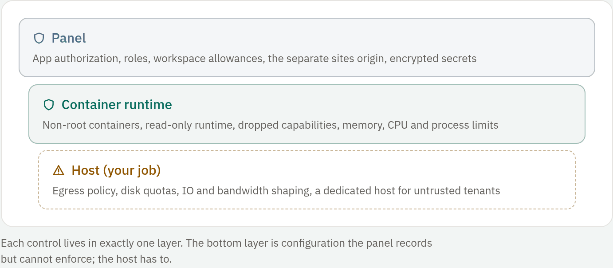

## Layers of enforcement

Every boundary in RivetPanel is held by one of three layers, or by none. This
guide marks each claim with the layer that enforces it.

<!-- figure: security-boundary -->


| Badge | Who enforces it |
| --- | --- |
| [enforced: docker] | The container runtime and the kernel underneath it (cgroups, capabilities, seccomp, mounts) |
| [enforced: panel] | RivetPanel's own code, when it accepts a request or starts work |
| [enforced: host] | Something you configure on the host: a firewall, traffic shaping, the systemd unit |
| [not enforced] | Recorded or reported, but nothing stops it |

A limit the panel enforces is an admission rule: the panel refuses to create
or start something. It is not a kernel limit on a running process.

## Production checklist

- Put the panel behind TLS (see [Install](01-install.md#reverse-proxy-and-tls)).
- Keep the encryption keys outside the database backups.
- Never mount the Docker socket into bot containers. The panel host itself
  must be treated as privileged while it owns that socket.
- Turn off outbound networking for apps that do not need it, and add a host
  egress policy for the rest.
- Use a dedicated host for untrusted tenants.

Stronger isolation, egress allowlists, disk quotas, malware scanning and
signed runtime verification are tracked hardening work, not features today.

## What every container gets

Bots, game servers, site web apps, container apps, add-ons and every build,
install or release container share one host configuration. The Docker adapter
builds it (unit-tested), and integration tests assert it from inside real
containers.

| Setting | Value | |
| --- | --- | --- |
| Memory and swap | `Memory = MemorySwap =` the configured cap | [enforced: docker] |
| CPU | `NanoCPUs` | [enforced: docker] |
| Processes | `PidsLimit` | [enforced: docker] |
| User | Non-root `uid:gid` (default `65532:65532`); the workspace is handed to it | [enforced: docker] |
| Capabilities | All dropped; no privileged mode, no devices | [enforced: docker] |
| Security options | Default seccomp kept, `no-new-privileges` | [enforced: docker] |
| Root file system | Read-only; `/tmp` is a bounded `nosuid,nodev` tmpfs | [enforced: docker] |
| Mounts | The unit's own workspace at `/workspace`; a site web app also gets its data folder at `/data`; an add-on gets only its own data folder | [enforced: docker] |
| Host namespaces, devices, Docker socket | None | [enforced: docker] |
| Published ports | None unless configured | [enforced: docker] |
| Logging | `json-file`, 3 × 10 MiB | [enforced: docker] |
| Restart policy | None; the runner decides | [enforced: panel] |
| Command | The main process runs in exec form, with no shell. Build, install and release commands run as `sh -c` in their own limited containers | [enforced: panel] |

### Images and builds

- Builds run in separate resource-limited containers that receive only the
  runtime recipe's environment, never an app's secrets. [enforced: panel]
- Image references are chosen by administrators, never by the person starting
  a unit, except for container apps. Bots and site web apps use the runtime
  catalog (`runtimes/*.yaml`). Game servers use their server type's blueprint,
  built in (`blueprints/*.yaml`) or saved by an account with
  `blueprints.manage`. [enforced: panel]
- Blueprints imported from Pterodactyl eggs have their image references
  checked for shape only and then pulled as written. Treat
  `blueprints.manage` as able to choose any image the host runs.
- A start request cannot supply an image, mount or flag, and Dockerfiles are
  never built. [enforced: panel]
- Runtime image digests are resolved and pinned in memory per process. To pin
  them permanently, put `digest:` and `builder_digest:` in the catalog YAML
  under `RIVET_RUNTIMES_DIR`.

### Evidence

`make integration` verified this on Linux 7.2, cgroup v2 and rootless Docker
29.7.2 with the systemd cgroup driver. For all six runtimes the
kernel-reported `memory.max`, `cpu.max` and `pids.max` inside the container
equal the configured limits; the root file system rejects writes; the
workspace is writable and visible on the host; no Docker socket exists; and a
bot that allocates past its cap is OOM-killed and reported as
`killed: out of memory` (exit 137).

The runner refuses to start reconciling unless the daemon can enforce memory,
CPU and PID limits. [enforced: panel] A rootless daemon on the **cgroupfs**
driver reports the controllers as available but silently ignores limits, so
the adapter detects rootless without systemd and reports the host as unable
to enforce limits.

## The panel itself

The panel process holds the Docker socket, which makes it root-equivalent on
the host. Its systemd sandbox reduces the blast radius but cannot isolate that
privilege; only a separate runner process could, and none exists. The same is
true of the container image: do not treat its container as a boundary for the
panel. On remote nodes, each `rivet-agent` holds its node's Docker socket in
the same way.

SFTP runs in the panel process too, but reaches files only through the
contained filesystem layer. [enforced: panel] **Kill** sends `SIGKILL` through
the Docker API with the same socket access as every other lifecycle action.

## What is not provided

> [!WARNING]
> There is no egress policy and no disk quota out of the box. Do not assume
> otherwise when you host people you do not trust.

- **Admission limits are application rules.** The panel refuses to create
  apps or sites past a workspace allowance (count, memory, CPU), refuses app
  sizes past the node maximum, and refuses starts past the node budget
  `RIVET_NODE_MEMORY_BYTES`. [enforced: panel] Disk use and inodes are not
  counted at all. [not enforced] See [Limits and allowances](../06-teams/04-limits.md).
- **No disk quota.** Workspaces and Docker logs consume host disk. Logs are
  rotated; workspaces are not capped beyond upload limits. [not enforced]
- **Bandwidth limits are not enforced.** Bandwidth intent is recorded, but
  enforcing it needs host traffic shaping. [not enforced]
- **Egress is not restricted.** Discord needs outbound access, and the default
  Docker bridge lets an app reach host services and other private networks,
  such as cloud metadata at `169.254.169.254` or the Docker host's own ports.
  [not enforced] Add a host firewall policy.

### A starting egress policy

This is a starting point, **not verified** in the project's test environment
(rootless, unprivileged). Point the panel at a dedicated bridge with
`RIVET_CONTAINER_NETWORK`, then drop forwarded traffic to private ranges and
traffic to the host itself. [enforced: host]

```sh
docker network create --driver bridge --subnet 172.30.0.0/16 \
    -o com.docker.network.bridge.name=rvbr0 \
    -o com.docker.network.bridge.enable_icc=false rivetpanel
# RIVET_CONTAINER_NETWORK=rivetpanel
nft add table inet rivetpanel_egress
nft add chain inet rivetpanel_egress fwd '{ type filter hook forward priority -1; }'
nft add rule  inet rivetpanel_egress fwd iifname rvbr0 ip daddr '{ 10.0.0.0/8, 172.16.0.0/12, 192.168.0.0/16, 169.254.0.0/16 }' drop
nft add chain inet rivetpanel_egress in  '{ type filter hook input priority -1; }'
nft add rule  inet rivetpanel_egress in  iifname rvbr0 drop
```

### User IDs under rootless Docker

Under rootless Docker or `userns-remap`, container uid N is not host uid N.
Set `RIVET_WORKSPACE_OWNER` to the *host* `uid:gid` that maps to the container
user; see [Workspace ownership](02-configuration.md#workspace-ownership). The
integration tests ran the container as uid 0, which under rootless Docker maps
to the unprivileged host user; the default non-root `65532` path, which needs
`CAP_CHOWN`, was **not** exercised there.

## Features that widen what an app can reach

None of these changes the container defaults above.

| Feature | What it opens, and its guard |
| --- | --- |
| Published ports | Opt-in per app, made by the owner or an administrator only, within `RIVET_PORT_RANGE`, on `127.0.0.1` unless public binding is on. [enforced: panel] Anyone who can reach that host address reaches the port, so put authentication in front of it. Verified with a real container |
| Outbound access off | Runs the app on Docker's `none` network, loopback only. [enforced: docker] Verified: a DNS lookup failed. Build containers keep network access to download dependencies, so a build script can still reach the internet and, without an egress policy, your private networks |
| GitHub deployments | Never run repository code on the host: the panel downloads a tarball and unpacks it with the contained extractor. Build scripts run only in the resource-limited build container, like uploaded code. [enforced: panel] |
| Custom build commands | Run as `sh -c` in the same build container, with the same limits, network access and no app variables. No privilege beyond package-manager install scripts, but review a suggested command (from repository analysis or the AI) before using it |
| Add-ons | PostgreSQL, Redis, MongoDB and MariaDB run with the same defaults as bots, on a per-app Docker network created `Internal: true`. [enforced: docker] Verified: a container on it could not reach the internet, while the bot reached both the internet and its add-on by name. Other apps are not attached. Redis runs without a password, so the network is its only access control. The panel host can reach bridge addresses directly |
| Discord avatar lookup | Sends the bot's own token from the panel to `discord.com` only, on request |
| Java builds | Download Maven into the workspace inside the build container, verified against a SHA-512 pinned in `runtimes/java.yaml`; dependencies then come from Maven Central. Point `RIVET_RUNTIMES_DIR` at your own recipe to use a mirror |

## Game servers

- **Ports are public by default.** A game server's allocations are published
  for TCP and UDP on `0.0.0.0`, or on the allocation's bound IP, because
  players must reach them. They come from the pool under
  **Administration → Allocations**. See [Ports](../03-game-servers/04-ports.md).
- **Installation** downloads server software in the panel, verifying
  checksums where the provider publishes them, and runs the blueprint's
  install script or SteamCMD (anonymous login) in a separate install
  container with the defaults above, as the unprivileged server user, with
  network access. Install scripts from imported eggs run the same way.
- The egress caveat applies: a game server reaches the internet and, without
  a host firewall policy, your private networks.

## Site web apps

- **One shared apps network.** Every site web app joins one routable bridge,
  `RIVET_APPS_NETWORK` (default `rivetpanel-apps`), so the sites listener can
  proxy to it. Inter-container traffic is on for it, so **site apps can reach
  each other**: treat them as mutually trusting or add a firewall policy.
  [not enforced] Their add-ons stay on each app's own internal network.
- Apps are reached only through the sites listener and publish no host ports.
  [enforced: docker] They always run on the panel's own host.
- A **release command**, such as database migrations, runs as `sh -c` once
  per deployment in a one-shot container shaped like the app: same image,
  variables, networks and `/data`.

## Container apps and stacks

A container app runs an image its owner chose. The new exposure is the image's
supply chain: its code, and whatever it downloads at start, run in the same
sandbox a bot's code runs in. Treat container apps as trusted-tenant until
egress and disk quotas are enforced.

- **Registry allowlist.** `RIVET_CONTAINER_REGISTRIES` (default
  `docker.io,ghcr.io,quay.io`) is checked when the app is created or its image
  changes, and again by the runner before every pull, so narrowing the list
  stops existing apps from pulling refused images. [enforced: panel] The
  Docker daemon contacts the registries from the host network. Registry
  accounts are never stored, so only public images work.
- **Image size** is checked after the pull against
  `RIVET_CONTAINER_MAX_IMAGE_BYTES` (default 2 GiB). [enforced: panel] A
  refused image stays in Docker's image store until pruned, and pulls use host
  disk, which is not otherwise limited.
- **Non-root user.** Image code runs as the panel's container user or a
  numeric `uid:gid` above 0 [enforced: panel], with every default above.
  [enforced: docker]
- **Writable paths** are 16 MiB tmpfs mounts. Volumes are bind mounts of
  `volumes/<name>` inside the app's own files, so they stay within backups.
  Volume and writable paths under `/proc`, `/sys`, `/dev` and Docker's
  `/etc/hosts`, `/etc/hostname` and `/etc/resolv.conf` are refused.
  [enforced: panel]
- **Ports** follow the same opt-in policy as bots.
- **Stacks** get one Docker network each (`rivetpanel-stack-<id>`), created
  `Internal: true`: services reach each other by service name and nothing
  else, and keep their own outbound access on the default network unless it
  is turned off. Different stacks and standalone apps are not attached to each
  other's networks. [enforced: docker]
- **Compose import is translation, not execution.** The panel never runs
  `docker compose`; it maps a fixed set of keys onto container apps and
  refuses privileged mode, added capabilities, security options, devices,
  sysctls, host PID, IPC or network namespaces, the Docker socket, builds and
  other keys that would widen the boundary. [enforced: panel] See
  [Containers](../02-apps/08-containers.md).

## Extensions

Extension code runs inside the panel process as WebAssembly, so it shares the
panel's operating-system privileges; the boundary is the WebAssembly sandbox
and the checks on every host call, not a separate process or user.
[enforced: panel] It has no files, environment, sockets or Docker access, and
reaches the outside only through `http.fetch` to the hosts its manifest lists.
Memory is capped per extension and calls have a wall-clock deadline, but there
is no CPU metering within a call. Database-browser queries run in disposable,
capability-free client containers; their read-only mode guards against
mistakes and is not a security boundary for the person querying. The full
model is in [Extensions](09-extensions.md#security-model).
